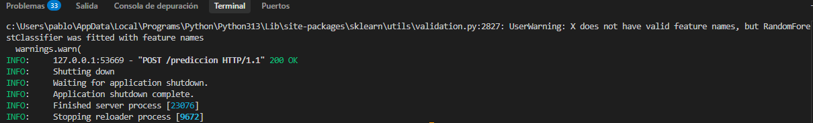
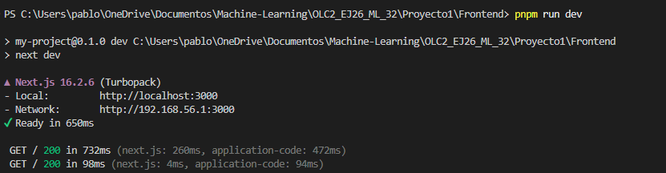
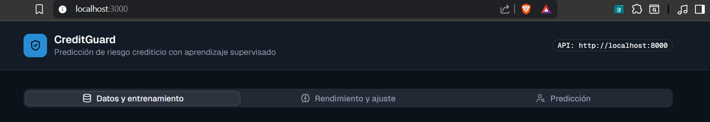
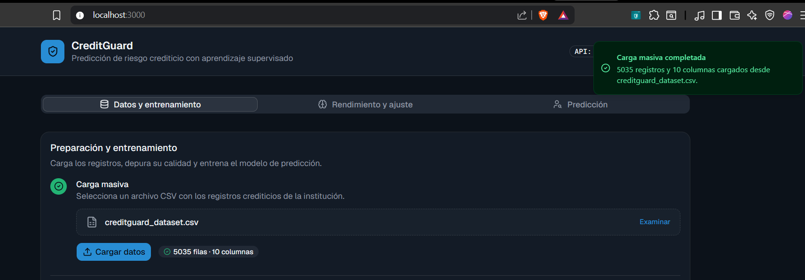
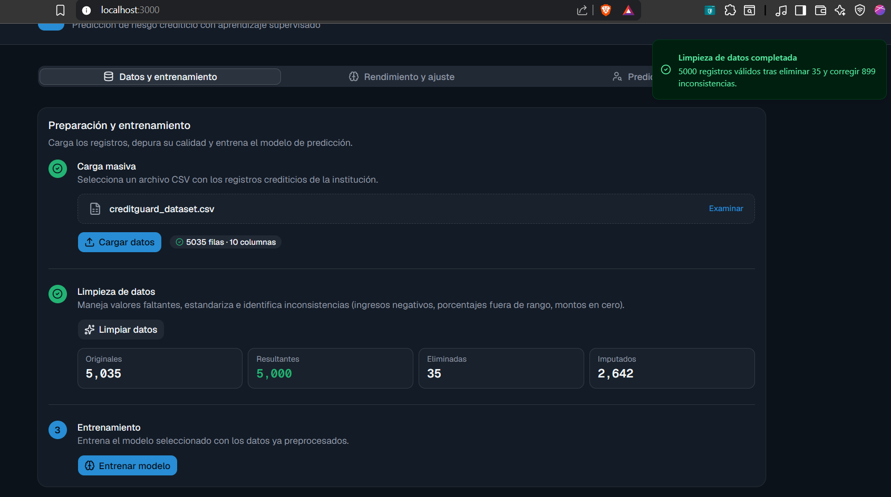
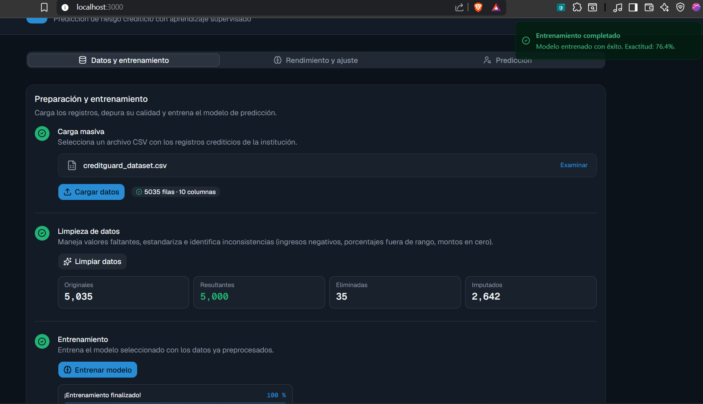
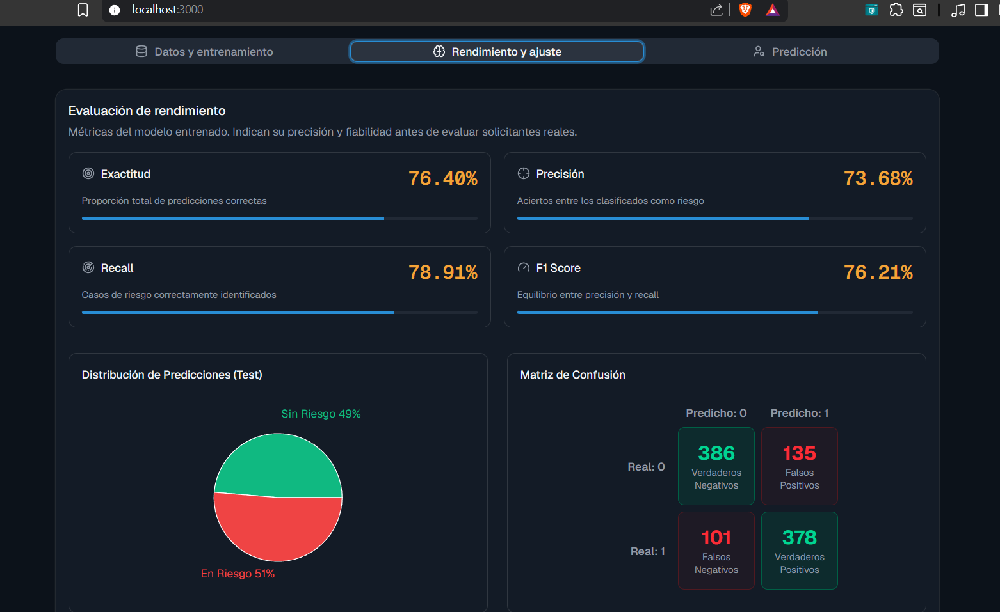
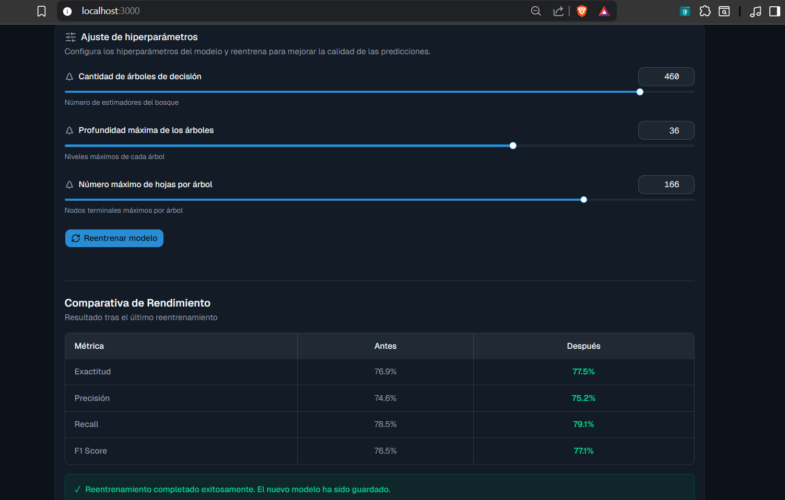
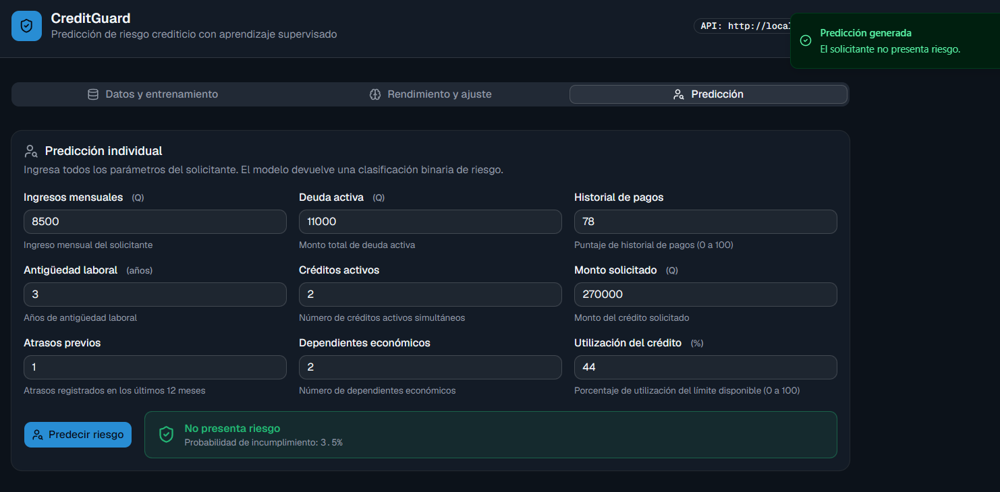

<div align="center">


## UNIVERSIDAD DE SAN CARLOS DE GUATEMALA

### FACULTAD DE INGENIERÍA

### ORGANIZACIÓN DE LENGUAJES Y COMPILADORES 2

<br><br>

# MANUAL DE USUARIO - CreditGuard
**Catedrático:** M.Sc. Luis Fernando Espino Barrios

**Auxiliar Laboratorio:** Carlos Fernando Enrique Lopez Garcia

**Grupo:**  32
</div>

---

### Tabla de Contenidos

- [1. Introducción](#1-introducción)
- [2. Requisitos del Sistema](#2-requisitos-del-sistema)
- [3. Instalación y Configuración](#3-instalación-y-configuración)
- [4. Interfaz Principal](#4-interfaz-principal)
- [5. Carga Masiva de Datos](#5-carga-masiva-de-datos)
- [6. Limpieza de Datos](#6-limpieza-de-datos)
- [7. Entrenamiento del Modelo](#7-entrenamiento-del-modelo)
- [8. Evaluación de Rendimiento](#8-evaluación-de-rendimiento)
- [9. Ajuste de Hiperparámetros](#9-ajuste-de-hiperparámetros)
- [10. Predicciones Individuales](#10-predicciones-individuales)
- [11. Consejos de Uso y Mejores Prácticas](#11-consejos-de-uso-y-mejores-prácticas)
- [12. Solución de Problemas](#12-solución-de-problemas)
- [13. Contacto y Soporte](#13-contacto-y-soporte)

---

### 1. Introducción

**CreditGuard** es una aplicación web diseñada para apoyar a instituciones financieras en la evaluación automática del riesgo crediticio mediante técnicas de **aprendizaje supervisado**. 

El sistema permite cargar datos históricos en formato CSV, realizar limpieza automática de datos, entrenar un modelo de **Bosque Aleatorio (Random Forest)**, evaluar su rendimiento y realizar predicciones individuales sobre nuevos solicitantes de crédito.

**Objetivo principal:** Ayudar a los analistas de crédito a tomar decisiones más informadas, rápidas y objetivas, reduciendo el riesgo de incumplimiento.

**Características principales:**
- Carga masiva de datos institucionales
- Preprocesamiento y limpieza inteligente
- Entrenamiento y ajuste del modelo
- Métricas detalladas de rendimiento
- Predicción en tiempo real para solicitudes individuales

---

### 2. Requisitos del Sistema

**Para ejecutar la aplicación:**

- **Python 3.8 o superior**
- Bibliotecas principales: `pandas`, `scikit-learn`, `streamlit` (o framework elegido para frontend)
- Memoria RAM recomendada: 8 GB o más
- Navegador web moderno (Chrome, Firefox, Edge)

**Formato de datos requerido:**
- Archivo CSV con las siguientes columnas exactas:
  - `ingresos_mensuales`
  - `deuda_activa`
  - `historial_pagos`
  - `antiguedad_laboral`
  - `creditos_activos`
  - `monto_solicitado`
  - `atrasos_previos`
  - `dependientes_economicos`
  - `utilizacion_credito`
  - `target` (variable objetivo: 1 = riesgo de incumplimiento, 0 = sin riesgo)

---

### 3. Instalación y Configuración

**Paso a paso:**

1. Clonar el repositorio desde GitHub.
2. Instalar las dependencias:
   ```bash
   pip install -r requirements.txt
   ```
3. Ejecutar la aplicación:
   ```bash
   pnpm run dev
   uvicorn app.main:app --reload
   ```
4. Abrir la URL que se muestra en la terminal (normalmente `http://localhost:3000`).




---

### 4. Interfaz Principal

La interfaz está dividida en una barra lateral de navegación y un área de contenido principal.

**Menú lateral:**
- Carga y Entrenamiento
- Evaluación de Rendimiento
- Ajuste de Hiperparámetros
- Predicciones



---

### 5. Carga Masiva de Datos

Esta sección permite subir los datos históricos de la institución.

**Pasos:**

1. Haga clic en **"Seleccionar archivo CSV"**.
2. Seleccione su archivo de datos.
3. Haga clic en **Cargar Datos**.

El sistema mostrará:
- Cantidad de registros cargados




---

### 6. Limpieza de Datos

Una vez cargados los datos, presione el botón **"Limpiar Datos"**.

**Acciones que realiza el sistema automáticamente:**
- Eliminación de duplicados
- Manejo de valores faltantes (imputación con mediana/moda según columna)
- Corrección de valores fuera de rango (ingresos negativos, porcentajes >100, etc.)
- Estandarización de tipos de datos
- Número de duplicados eliminados
- Número de valores nulos detectados




---

### 7. Entrenamiento del Modelo

Después de limpiar los datos:

1. Vaya a la sección **Entrenamiento**.
2. Haga clic en **"Entrenar Modelo"**.

El sistema entrenará un modelo **Random Forest** con los datos preprocesados.




---

### 8. Evaluación de Rendimiento

Esta sección muestra el desempeño del modelo entrenado.

**Métricas mostradas:**
- Exactitud (Accuracy)
- Precisión (Precision)
- Recall
- F1 Score

**Visualizaciones incluidas:**
- Distribución de predicciones
- Matriz de Confusión
- Gráficos comparativos



---

### 9. Ajuste de Hiperparámetros

Permite mejorar el modelo ajustando sus parámetros principales.

**Parámetros configurables:**

- **Cantidad de árboles de decisión** (recomendado: 50-500)
- **Profundidad máxima de los árboles** (recomendado: 5-30)
- **Número máximo de hojas por árbol** (recomendado: 10-200)

**Pasos para ajustar:**
1. Modifique los valores deseados.
2. Presione **"Reentrenar Modelo"**.
3. Compare las métricas **Antes** vs **Después**.



---

### 10. Predicciones Individuales

Una vez que el modelo tiene un rendimiento aceptable, puede realizar predicciones para solicitantes específicos.

**Pasos:**

1. Navegue a la sección **Predicciones**.
2. Complete todos los campos del formulario:
   - Ingresos mensuales
   - Deuda activa
   - Historial de pagos
   - Antigüedad laboral
   - Créditos activos
   - Monto solicitado
   - Atrasos previos
   - Dependientes económicos
   - Utilización del crédito

3. Haga clic en **"Realizar Predicción"**.

**Resultado:**
- **EN RIESGO DE INCUMPLIMIENTO** (rojo)
- **SIN RIESGO DETECTADO** (verde)



---

### 11. Consejos de Uso y Mejores Prácticas

- Siempre realice la **limpieza de datos** antes de entrenar.
- Use datasets con al menos 1,000 registros para mejores resultados.
- Ajuste los hiperparámetros si la precisión es menor al 85%.
- Guarde capturas de pantalla de las métricas para reportes.
- Realice predicciones solo después de validar el modelo.

---

### 12. Solución de Problemas

| Problema | Posible Causa | Solución |
|----------|---------------|----------|
| Error al cargar CSV | Columnas faltantes o nombres incorrectos | Verifique que las columnas coincidan exactamente con la especificación |
| Entrenamiento muy lento | Demasiados árboles o datos muy grandes | Reduzca la cantidad de árboles inicialmente |
| Métricas muy bajas | Datos desbalanceados o poca calidad | Realice más limpieza o recolecte más datos |
| Predicción no disponible | Modelo no entrenado | Entrene primero el modelo |

---

### 13. Contacto y Soporte

Para dudas técnicas sobre el proyecto, favor contactar al desarrollador.

**Créditos:**
- Proyecto desarrollado para el curso **Organización de Lenguajes y Compiladores 2**
- Universidad de San Carlos de Guatemala
- Facultad de Ingeniería - Ingeniería en Ciencias y Sistemas