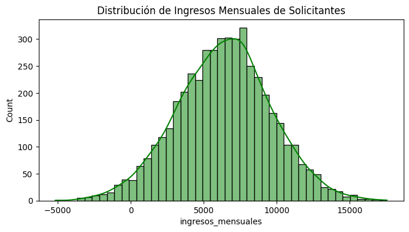
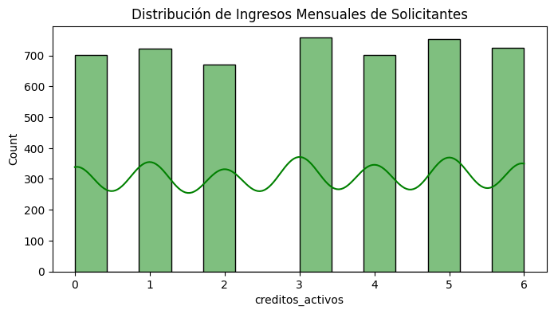
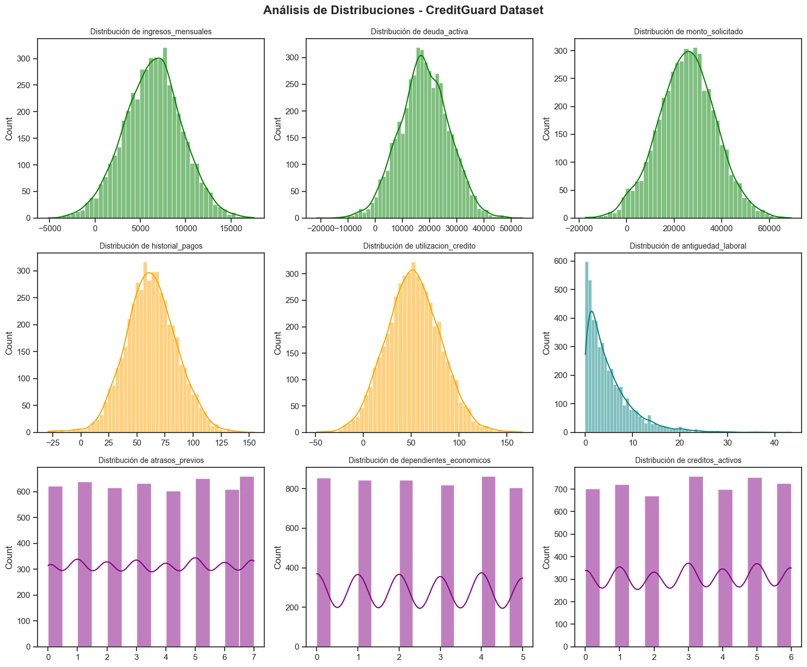
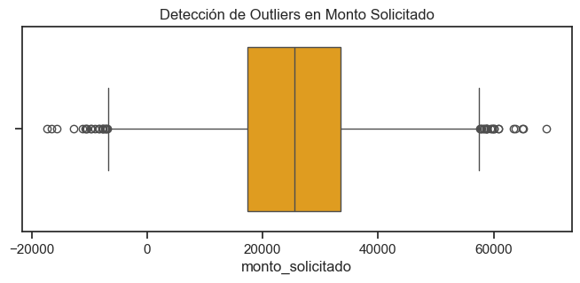
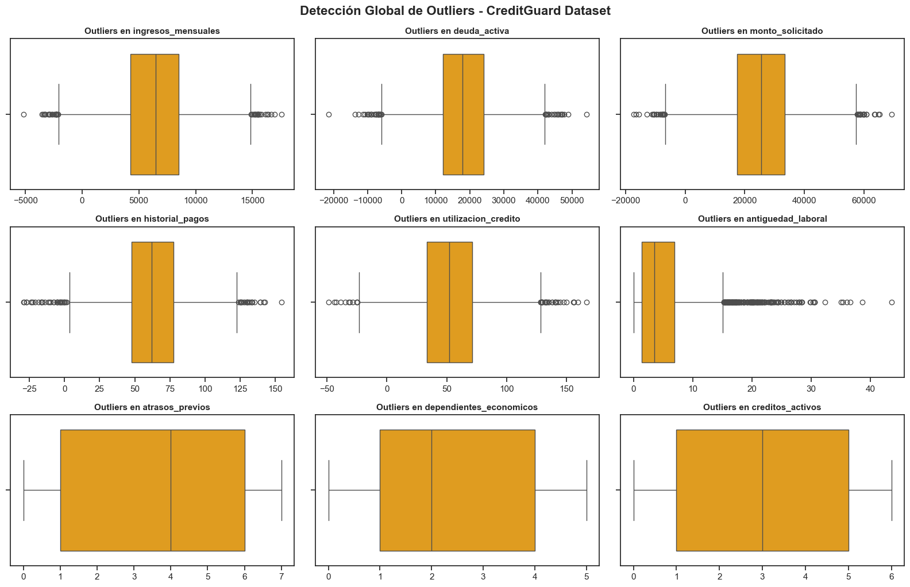
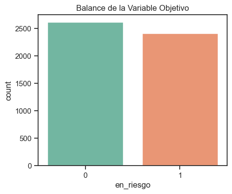
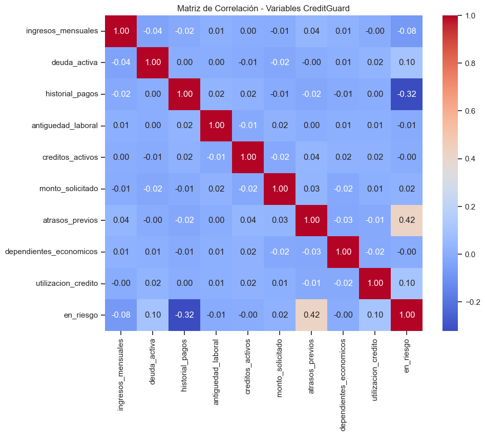
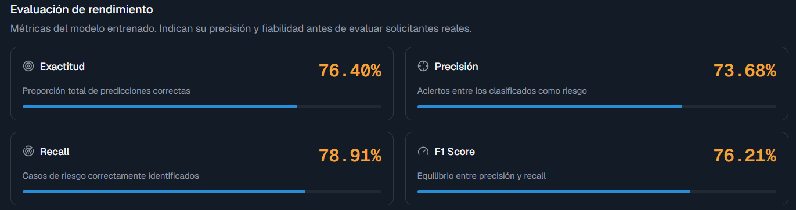
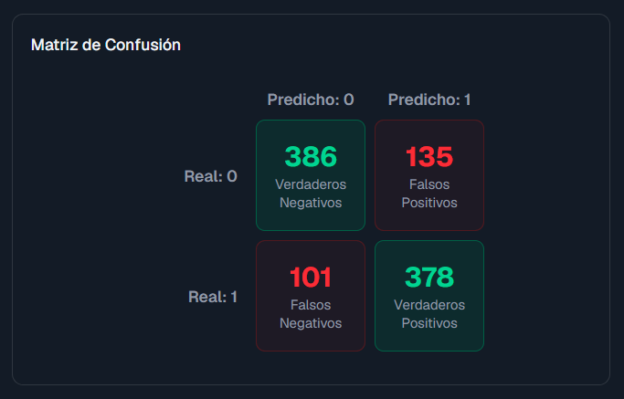
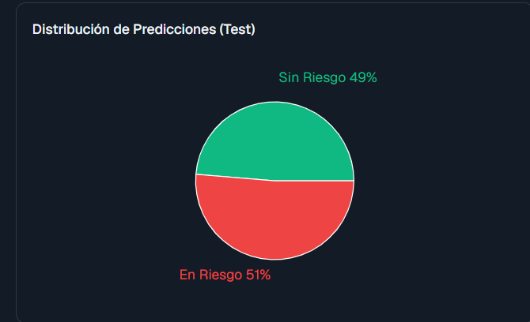

<div align="center">


## UNIVERSIDAD DE SAN CARLOS DE GUATEMALA

### FACULTAD DE INGENIERÍA

### ORGANIZACIÓN DE LENGUAJES Y COMPILADORES 2

<br><br>

# MANUAL TECNICO - CreditGuard
**Catedrático:** M.Sc. Luis Fernando Espino Barrios

**Auxiliar Laboratorio:** Carlos Fernando Enrique Lopez Garcia

**Grupo:**  32
</div>

---
### Tabla de Contenidos

- [1. Análisis Exploratorio de Datos (EDA)](#1-análisis-exploratorio-de-datos-eda)
- [2. Limpieza de Datos](#2-limpieza-de-datos)
- [3. Estrategia de Limpieza y Preprocesamiento de Datos Crediticios](#3-estrategia-de-limpieza-y-preprocesamiento-de-datos-crediticios)
- [4. Propuesta de Modelo: Random Forest](#4-propuesta-de-modelo-random-forest)
- [5. Justificación Técnica del Modelo](#5-justificación-técnica-del-modelo-random-forest)
- [6. Entrenamiento y Evaluación](#6-entrenamiento-y-evaluación)
- [7. Métricas de Evaluación del Modelo](#7-métricas-de-evaluación-del-modelo)
- [8. Ajuste de Hiperparámetros](#8-ajuste-de-hiperparámetros)
- [9. Predicciones](#9-predicciones)


### Análisis Exploratorio de Datos (EDA)

Antes de diseñar el pipeline de limpieza y entrenamiento, se realizó un análisis exploratorio de los datos en un entorno de desarrollo independiente utilizando Google Colab. El objetivo fue comprender mejor la calidad de la información, detectar posibles problemas en el conjunto de datos e identificar patrones y tendencias relevantes para el proyecto CreditGuard. Para apoyar este análisis se utilizó la librería Seaborn, la cual permitió generar diferentes visualizaciones gráficas que facilitaron la interpretación de los datos.

Para poder crear esta graficar se puede utilizar del siguiente codigo despues de la limpieza en colab

```python
plt.figure(figsize=(8, 4))
sns.histplot(df['ingresos_mensuales'], kde=True, color='blue')
plt.title('Distribución de Ingresos Mensuales de Solicitantes')
plt.show()
```
#### **Ejemplo Ingresos Mensuales**




#### **Ejemplo con los Creditos Activos**




#### Grafica de todas variables



#### Variables monetarias continuas:

Las variables monetarias continuas, como **ingresos_mensuales**, **deuda_activa** y **monto_solicitado**, presentaron una distribución sesgada hacia la derecha. En todos los casos, la media fue superior a la mediana, lo que indica la presencia de valores extremos elevados. Debido a este comportamiento, se determinó que la mediana era una medida más representativa para la imputación de valores faltantes, ya que es menos sensible a valores atípicos que la media.

#### Variables de puntaje y porcentaje:

Las variables **historial_pagos** y **utilizacion_credito** mostraron distribuciones más estables dentro de sus rangos esperados. Sin embargo, en el caso de **utilizacion_credito** se observó una concentración importante de registros en los valores más bajos y más altos del rango, sugiriendo que muchos solicitantes utilizan una porción muy pequeña o muy grande de su crédito disponible. Por esta razón, los valores fuera del intervalo válido se convierten en **NaN** durante la limpieza y posteriormente se imputan con la **mediana**, en lugar de aplicar un recorte directo.

#### Variables de conteo:

Las variables **atrasos_previos**, **dependientes_economicos** y **creditos_activos** presentaron una alta concentración de registros en valores bajos, disminuyendo progresivamente a medida que aumentaba el conteo. Este comportamiento es común en variables de conteo, ya que la mayoría de los solicitantes tiene pocos atrasos, pocos dependientes económicos y una cantidad limitada de créditos activos. Debido a ello, la imputación de valores faltantes con el valor más frecuente de cada columna se consideró adecuada, ya que respeta mejor la distribución observada en el dataset limpio.

#### Antigüedad laboral:

La variable **antiguedad_laboral** mostró una distribución relativamente uniforme entre los 0 y 15 años de experiencia, aunque con una ligera concentración en los primeros años. Esto refleja la presencia de perfiles tanto con poca experiencia laboral como de trabajadores con una trayectoria más consolidada. Dado que la distribución no presentó una asimetría significativa, la mediana se consideró una opción apropiada para la imputación de valores faltantes.

### 2. Detección de outliers

A través de los diagramas de caja (*boxplots*) comparativos por clase, se observó que los valores atípicos de variables como **atrasos_previos** e **ingresos_mensuales** aparecen con mayor frecuencia en los registros clasificados como **en_riesgo = 1**. Esto sugiere que dichos valores extremos no corresponden a errores o ruido en los datos, sino que contienen información relevante para la predicción del riesgo crediticio.

Por esta razón, se optó por conservar los registros que contienen valores atípicos, evitando su eliminación durante la etapa de limpieza. En su lugar, únicamente se aplicaron técnicas de imputación basadas en la mediana cuando existían valores faltantes o inconsistentes.

Las variables monetarias, como **ingresos_mensuales**, **deuda_activa** y **monto_solicitado**, concentraron la mayor cantidad de valores atípicos en los rangos superiores, un comportamiento coherente con la asimetría positiva identificada previamente en sus distribuciones. Por otro lado, las variables de conteo, entre ellas **atrasos_previos** y **creditos_activos**, presentaron valores extremos asociados a solicitantes con patrones crediticios poco comunes o de mayor riesgo.

Finalmente, la variable **utilizacion_credito** mostró una cantidad reducida de valores atípicos, lo cual era esperable debido a que sus valores se encuentran restringidos al intervalo válido entre 0 y 100.

```python
plt.figure(figsize=(8, 3))
sns.boxplot(x=df['monto_solicitado'], color='orange')
plt.title('Detección de Outliers en Monto Solicitado')
plt.show()
```
#### Ejemplo con los montos solicitados



#### Ejemplo con todas las variables


### 3. Balance de clases

Se evaluó la distribución de la variable objetivo **en_riesgo** con el propósito de verificar si existía un desbalance significativo entre las clases. Este análisis es importante porque una distribución muy desigual puede afectar el proceso de aprendizaje del modelo, llevándolo a favorecer la clase más frecuente y reduciendo su capacidad para identificar correctamente los casos menos representados.

La revisión de esta característica permitió determinar si era necesario aplicar técnicas adicionales para manejar el desbalance de clases y garantizar un entrenamiento más confiable y representativo de la realidad de los datos.

```python
plt.figure(figsize=(5, 4))
sns.countplot(x='en_riesgo', data=df, palette='Set2')
plt.title('Balance de la Variable Objetivo')
plt.show()
```


### 4. Correlaciones observadas

Con el objetivo de identificar posibles relaciones entre las variables del conjunto de datos, se calculó una matriz de correlación utilizando el coeficiente de **Pearson**. Este análisis permitió evaluar la intensidad y dirección de la relación lineal entre las distintas características, incluyendo la variable objetivo **en_riesgo**.

Se optó por utilizar la correlación de Pearson debido a que la mayoría de las variables son de naturaleza continua y el interés principal era detectar dependencias lineales que pudieran resultar útiles durante el proceso de modelado. Los resultados obtenidos sirvieron como una primera aproximación para comprender la interacción entre las variables y determinar cuáles podrían tener una mayor influencia en la predicción del riesgo crediticio.

```python
plt.figure(figsize=(10, 8))
matriz_corr = df.corr()
sns.heatmap(matriz_corr, annot=True, cmap='coolwarm', fmt=".2f")
plt.title('Matriz de Correlación - Variables CreditGuard')
plt.show()
```


El análisis de correlación entre las variables predictoras mostró que no existen pares de características con coeficientes superiores a **0.7**, lo que indica la ausencia de problemas significativos de multicolinealidad. En términos prácticos, esto sugiere que cada variable aporta información distinta y complementaria al conjunto de datos, reduciendo la presencia de características altamente redundantes.

Este resultado es positivo para el proceso de modelado, ya que permite que los algoritmos aprovechen mejor la información disponible. En particular, para **Random Forest**, la baja correlación entre las variables favorece la construcción de árboles más diversos, lo que contribuye a mejorar la capacidad predictiva del modelo y a reducir el riesgo de que múltiples características representen esencialmente la misma información.

## Limpieza de Datos

### Problemas Identificados en el dataset

Durante la fase de exploración y auditoría del dataset se detectaron diversos problemas de calidad que podían afectar el proceso de entrenamiento del modelo y la confiabilidad de los resultados obtenidos. Entre las inconsistencias encontradas se identificaron valores faltantes (**NaN**), representados por campos vacíos dentro del archivo CSV, así como registros con valores negativos en variables donde este tipo de dato no es válido.

También se encontraron montos con valor **0** en campos donde dicho valor resulta inconsistente con el contexto de la información financiera analizada. Adicionalmente, se detectaron filas duplicadas que podían generar una representación incorrecta de ciertos registros y afectar la distribución real de los datos.

Por último, se identificaron valores fuera de los rangos permitidos, especialmente en variables expresadas como porcentajes o con límites previamente definidos. Para cada una de estas situaciones se aplicaron procedimientos de limpieza y validación con el fin de garantizar que los datos utilizados durante el entrenamiento fueran consistentes y representativos del problema a resolver.


Antes de entrenar el modelo, el sistema realiza un preprocesamiento de la información para mejorar la calidad de los datos.

Por ejemplo:

* Manejo de valores nulos
* Corrección de inconsistencias
* Validación de rangos inválidos
* Normalización de datos

## Estrategia de Limpieza y Preprocesamiento de Datos Crediticios

## 1. Tratamiento de Duplicados y Registro Basura

* **Duplicados:**
    * *Acción:* Eliminación directa. 
    * *Justificación:* Un registro idéntico en datos crediticios no representa una segunda solicitud real, sino un error de carga en el sistema.
* **Registro basura completo (todos en cero):**
    * *Acción:* Se elimina antes de cualquier otra etapa de limpieza.
    * *Justificación:* Intentar imputar datos sobre una fila completamente inválida introduciría "ruido fabricado" que alteraría el análisis.

---

## 2. Inconsistencias y Valores Fuera de Rango

> **Principio de diseño:** La razón de convertir los valores inconsistentes a `NaN` antes de imputar es mantener un solo punto de control unificado para todos los valores faltantes, evitando tener lógica dispersa a lo largo del código.

| Campo | Problema | Estrategia |
| :--- | :--- | :--- |
| `ingresos_mensuales` | Negativos o cero | Convertir a `NaN` → luego imputar con mediana |
| `monto_solicitado` | Igual a cero | Convertir a `NaN` → luego imputar con mediana |
| `historial_pagos` | Fuera del rango 0–100 | Convertir a `NaN` → luego imputar con mediana |
| `utilizacion_credito` | Fuera del rango 0–100 | Convertir a `NaN` → luego imputar con mediana |
| `antiguedad_laboral` | Negativa | Convertir a `NaN` → luego imputar con mediana |
| `deuda_activa` | Igual a cero | **Se conserva** — un solicitante sin deuda activa es un escenario perfectamente válido. |
| `creditos_activos` | Igual a cero | **Se conserva** — también representa un caso real y válido. |

---

## 3. Tratamiento de Valores Faltantes
*(Aplicado tras la conversión de inconsistencias a `NaN`)*

| Campo | Estrategia | Razón |
| :--- | :--- | :--- |
| `ingresos_mensuales`<br>`deuda_activa`<br>`monto_solicitado` | **Mediana** | Campos monetarios con alta varianza y presencia de *outliers* (valores atípicos); la mediana es más robusta que la media. |
| `historial_pagos`<br>`utilizacion_credito` | **Mediana** | Porcentajes acotados pero con una distribución potencialmente asimétrica. |
| `antiguedad_laboral` | **Mediana** | Razón similar; valores enteros positivos con distribución sesgada. |
| `atrasos_previos`<br>`dependientes_economicos`<br>`creditos_activos` | **Moda** | Valores enteros pequeños y discretos; la moda refleja fielmente el caso más frecuente. |

---

## 4. Estandarización de Datos

Al final del proceso se aplica `StandardScaler` sobre todas las columnas numéricas de entrada (excluyendo la variable objetivo `en_riesgo`).

* **¿Por qué es necesario?** Los rangos de las variables son muy dispares. Por ejemplo, `ingresos_mensuales` puede oscilar entre miles y decenas de miles, mientras que `atrasos_previos` se mantiene en un rango corto de 0 a 7.
* **Impacto:** Sin este escalamiento, el modelo de Machine Learning le otorgaría de forma implícita un mayor peso a las variables de gran magnitud, sesgando los resultados.

---

## Propuesta de Modelo: Random Forest

**Random Forest** es un modelo de ensamble que combina múltiples árboles de decisión para obtener una predicción final mediante un sistema de votación por mayoría. Para un caso de **riesgo crediticio**, este algoritmo es la opción ideal debido a su robustez, interpretabilidad y alineación con los requerimientos del problema.

## Modelos Considerados

**XGBoost :**
Generalmente supera a Random Forest en métricas puras, pero tiene desventajas para este contexto: más hiperparámetros que ajustar, más propenso a overfitting si no se regula bien, y con solo 30 registros de prueba puede no mostrar su ventaja real.

**Decision Tree :**
Un solo árbol es muy propenso a overfitting. Random Forest es básicamente "muchos Decision Trees corregidos", así que no tiene sentido elegir la versión inferior.

**Logistic Regression :**
Asume relaciones lineales entre las variables y el riesgo crediticio, lo cual rara vez se cumple en datos financieros reales. Por ejemplo, la relación entre deuda_activa e ingresos_mensuales interactúa de forma no lineal con el riesgo, y la regresión logística no captura eso bien sin ingeniería de features adicional.


---

## Justificación Técnica del Modelo (Random Forest)

### 1. Tolerancia a Datos Financieros Complejos
Los datos de crédito suelen presentar distribuciones asimétricas (por ejemplo, ingresos de los clientes) y valores atípicos (*outliers*). Random Forest maneja estos escenarios de forma excelente sin necesidad de transformaciones matemáticas complejas o una limpieza de datos perfecta.

### 2. Control Nativo del Sobreajuste (*Overfitting*)
A diferencia de un árbol de decisión único (que tiende a memorizar los datos de entrenamiento), Random Forest promedia los resultados de decenas o cientos de árboles independientes. Esta combinación reduce drásticamente la varianza y garantiza que el modelo generalice bien ante nuevos clientes.

### 3. Explicabilidad Financiera (*Feature Importance*)
El algoritmo calcula de forma nativa qué variables (como historial de pagos, nivel de ingresos o nivel de endeudamiento) tienen mayor peso en la predicción. En el sector bancario, esto es fundamental para auditar el modelo y justificar legal o institucionalmente la aprobación o rechazo de un crédito.

### 4. Alineación con los Requerimientos del Proyecto
Los hiperparámetros solicitados en el diseño del proyecto son la "firma" indiscutible de este algoritmo:

| Hiperparámetro | Función en el Modelo |
| :--- | :--- |
| **Cantidad de árboles** | Define el tamaño del ensamble (a mayor número, más estabilidad). |
| **Profundidad máxima** | Controla el nivel de detalle y complejidad de cada árbol. |
| **Hojas por árbol (`max_leaf_nodes`)** | Evita que los árboles creen reglas demasiado específicas para pocos clientes. |

>  **Conclusión:** La coincidencia exacta de estos parámetros sugiere que la arquitectura del proyecto fue diseñada por el catedrático pensando específicamente en la implementación de Random Forest.

---

##  Ventaja Estratégica
El modelo ofrece el equilibrio perfecto: brinda la **alta precisión** de los modelos modernos de Machine Learning sin convertirse en una "caja negra" indescifrable, manteniendo una lógica conceptual fácil de defender en una presentación académica o profesional.

## Entrenamiento y Evaluación

## Preparación y Entrenamiento del Modelo

Una vez finalizado el proceso de limpieza, el conjunto de datos quedó conformado por **5,000 registros válidos**. A partir de este dataset se seleccionaron como variables predictoras (**features**) las características `ingresos_mensuales`, `deuda_activa`, `historial_pagos`, `antiguedad_laboral`, `creditos_activos`, `monto_solicitado`, `atrasos_previos`, `dependientes_economicos` y `utilizacion_credito`. Por su parte, la variable **`en_riesgo`** fue definida como la variable objetivo que el modelo debía predecir.

Posteriormente, el dataset limpio se dividió en dos conjuntos: **80 % para entrenamiento** y **20 % para pruebas**, obteniendo 4,000 registros para entrenar el modelo y 1,000 para evaluar su desempeño. Esta partición se realizó mediante la función `train_test_split`, utilizando el parámetro `stratify=y` para conservar la misma proporción de clases en ambos conjuntos. Además, se estableció `random_state=42` con el fin de garantizar que la división de los datos sea reproducible en futuras ejecuciones.

Antes de esta etapa, el conjunto de datos ya había sido estandarizado con **StandardScaler** durante la limpieza, utilizando todas las variables predictoras y excluyendo la variable objetivo `en_riesgo`. De esta forma, las características llegaron al entrenamiento con una escala homogénea y el mismo escalador quedó almacenado para reutilizarse en predicciones individuales.

Como algoritmo de clasificación se utilizó **Random Forest**, configurado mediante hiperparámetros previamente validados. Durante el entrenamiento se empleó el método `.fit()` sobre los datos ya escalados y se habilitó el parámetro `n_jobs=-1`, permitiendo aprovechar todos los núcleos de procesamiento disponibles para reducir el tiempo de ejecución. Adicionalmente, el modelo se construyó con `class_weight="balanced"` para compensar el ligero desbalance entre clases observado en el dataset.

Los hiperparámetros iniciales utilizados fueron los siguientes:

- **n_estimators:** 100 árboles de decisión en el bosque.
- **max_depth:** profundidad máxima de 10 niveles por árbol.
- **max_leaf_nodes:** hasta 50 hojas máximas por árbol para controlar la complejidad del modelo.
- **random_state:** valor 42 para garantizar resultados reproducibles.
- **n_jobs:** uso de todos los núcleos disponibles del procesador.

Finalmente, una vez concluido el entrenamiento, el modelo se almacenó de forma permanente mediante **pickle** en el archivo `modelo.pkl`, mientras que el escalador utilizado durante la limpieza se guardó en `scaler.pkl`. Esta estrategia permite reutilizar los objetos entrenados sin necesidad de repetir todo el proceso de entrenamiento, facilitando futuras predicciones y asegurando la disponibilidad del modelo incluso después de reinicios o interrupciones del sistema.

## Métricas de Evaluación del Modelo

Antes de analizar los resultados obtenidos, es importante mencionar que la evaluación del modelo se realizó exclusivamente sobre el conjunto de prueba, es decir, utilizando datos que no participaron durante el entrenamiento. Esto permite medir de manera más objetiva la capacidad del modelo para generalizar y realizar predicciones sobre información nueva.

Los resultados generados durante esta etapa fueron encapsulados en la estructura de respuesta del endpoint de entrenamiento, la cual almacena las principales métricas de desempeño. Todas las métricas se expresan en un rango comprendido entre **0.0 y 1.0**, donde los valores más cercanos a **1.0** representan un mejor rendimiento predictivo.

### Exactitud (Accuracy)

La exactitud indica la proporción de predicciones correctas realizadas por el modelo respecto al total de registros evaluados. Esta métrica proporciona una visión general del desempeño, mostrando qué tan frecuentemente el modelo clasifica correctamente a los clientes.

### Precisión (Precision)

La precisión mide qué porcentaje de los clientes clasificados por el modelo como **"En Riesgo de Incumplimiento"** realmente pertenecen a dicha categoría. Un valor elevado de precisión implica una menor cantidad de **falsos positivos**, reduciendo los casos en los que se identifica erróneamente a un cliente como riesgoso.

### Recall (Sensibilidad)

El recall evalúa la capacidad del modelo para detectar a los clientes que realmente presentan riesgo de incumplimiento. Un valor alto indica que el algoritmo logra identificar correctamente una mayor proporción de los casos positivos reales, disminuyendo la cantidad de **falsos negativos**.

### F1 Score

El F1 Score combina la precisión y el recall en una única métrica mediante su media armónica. Esta medida resulta especialmente útil cuando existe desbalance entre las clases, ya que considera simultáneamente la capacidad del modelo para identificar correctamente los casos de riesgo y la confiabilidad de dichas predicciones. Por esta razón, suele considerarse una de las métricas más representativas para evaluar la robustez general del sistema.

#### Metricas obtenidas


### Matriz de Confusión


### Discusión de Resultados



### Interpretación 

#### Métricas

| Métrica   | Valor | Interpretación                                                                                                      |
| --------- | ----- | ------------------------------------------------------------------------------------------------------------------- |
| Exactitud | 76.40% | De cada 100 predicciones, 76.40 fueron correctas                                                                     |
| Precisión | 73.68% | De cada 100 clientes que CreditGuard etiqueta como "EN RIESGO", aproximadamente 74 realmente representan un peligro |
| Recall    | 78.91% | De cada 100 clientes realmente en riesgo, el modelo detectó 79 aproximadamente. |                                                    |
| F1 Score  | 76.21% | Al estar muy cerca de la exactitud, este indicador demuestra que el modelo es altamente equilibrado.|

#### Matriz de confusión

|                 | Predicho Sin Riesgo | Predicho En Riesgo |
| --------------- | :-----------------: | :----------------: |
| Real Sin Riesgo |         386         |        135         |
| Real En Riesgo  |         101         |        378         |    


- **386 Verdaderos Negativos (TN):** Corresponden a clientes que realmente no presentan riesgo de incumplimiento y que fueron clasificados correctamente como seguros. Estos resultados brindan confianza al momento de aprobar solicitudes de crédito con un riesgo reducido.

- **378 Verdaderos Positivos (TP):** Representan a los clientes que efectivamente presentan riesgo y que fueron identificados correctamente por el modelo. Este resultado demuestra la capacidad del sistema para detectar posibles casos de incumplimiento y apoyar la toma de decisiones preventivas.

- **135 Falsos Positivos (FP):** Son clientes que en realidad no presentan riesgo, pero que fueron clasificados por el modelo como potencialmente riesgosos. Aunque este error puede ocasionar el rechazo de solicitudes válidas o una evaluación adicional innecesaria, no genera pérdidas financieras directas para la institución.

- **101 Falsos Negativos (FN):** Corresponden a clientes que sí presentan riesgo de incumplimiento, pero que fueron clasificados erróneamente como seguros. Este tipo de error es especialmente crítico en el ámbito financiero, ya que puede llevar a la aprobación de créditos que posteriormente no serán pagados, provocando pérdidas económicas para la entidad.

En términos generales, los resultados muestran que el modelo logra identificar correctamente la mayoría de los casos de ambas clases. Sin embargo, los falsos negativos deben ser monitoreados cuidadosamente debido al impacto económico que pueden representar para la institución financiera.


El modelo predijo 49% sin riesgo y 51% en riesgo sobre el conjunto de prueba, una distribución muy cercana al balance real del dataset. Esto confirma que el modelo no colapsó hacia ninguna clase.

## Ajuste de Hiperparámetros

### Valores explorados

Se realizo una exploración de 10 valores diferentes.

| #    | Cant.Decision | Prof. Max | Num. Hojas | Exactitud | Precisión | Recall | F1 Score | FN  | FP  |
| ---- | :-----------: | :-------: | :--------: | :-------: | :-------: | :----: | :------: | :-: | :-: |
| Base |      100      |    10     |     50     |   77.6    |   73.6    |  78.9  |   76.21   | 101 | 135 |
| 1 | 120 | 14 | 64 | 77.6 | 74.5 | 81.0 | 77.6 | 91 | 133 |
| 2 | 230 | 21 | 86 | 76.5 | 73.6 | 79.3 | 76.4 | 99 | 136 |
| 3 | 230 | 21 | 86 | 76.5 | 73.6 | 79.3 | 76.4 | 99 | 136 |
| 4 | 360 | 31 | 130 | 77.2 | 75.0 | 78.7 | 76.8 | 102 | 126 |
| 5 | 390 | 38 | 138 | 77.1 | 74.8 | 78.7 | 76.7 | 102 | 127 |
| 6 | 410 | 45 | 156 | 76.9 | 74.5 | 78.7 | 76.6 | 102 | 129 |
| 7 | 470 | 45 | 176 | 77.3 | 75.0 | 78.9 | 76.9 | 101 | 126 |
| 8 | 150 | 17 | 20 | 76.7 | 72.4 | 83.1 | 77.4 | 81 | 152 |
| 9 | 190 | 17 | 30 | 76.8 | 73.1 | 81.0 | 76.8 | 91 | 141 |
| 10 | 210 | 18 | 40 | 77.0 | 73.5 | 81.1 | 77.1 | 90 | 138 |


### Impacto de los Hiperparámetros en el Rendimiento del Modelo

#### Número máximo de hojas por árbol (`max_leaf_nodes`)

Este fue uno de los hiperparámetros que tuvo mayor influencia en el equilibrio entre **precisión** y **recall**. Se observó que valores elevados, como 50, 99 y 200, permitieron construir árboles más complejos, lo que favoreció una mayor precisión en las predicciones. Sin embargo, esta mejora estuvo acompañada de una disminución en el recall, reduciendo la capacidad del modelo para detectar todos los casos reales de riesgo.

Por el contrario, valores bajos como 10 y 11 limitaron la complejidad de los árboles, obligando al modelo a generalizar más. Como resultado, se obtuvo un recall más alto, aunque con una ligera disminución en la precisión. Este comportamiento evidencia el compromiso existente entre identificar la mayor cantidad posible de clientes en riesgo y minimizar las falsas alarmas.

#### Profundidad máxima de los árboles (`max_depth`)

La profundidad máxima también tuvo un impacto importante en el comportamiento del modelo. Configuraciones con profundidades altas, como 31 y 45 niveles, especialmente cuando se combinaron con valores elevados de max_leaf_nodes, generaron modelos con una precisión superior pero con una menor capacidad de detección de casos positivos. Ejemplos de ello son los ajustes 4 y 7, que obtuvieron valores de recall de 78.7 % y 78.9 %, respectivamente.

En contraste, al reducir la profundidad a valores más bajos o combinarla con un número limitado de hojas, el recall mejoró considerablemente. Esto sugiere que los árboles muy profundos tienden a ajustarse excesivamente a patrones específicos del conjunto de entrenamiento, reduciendo su capacidad para generalizar correctamente ante nuevos datos.

#### Cantidad de árboles de decisión (`n_estimators`)

La cantidad de árboles fue el hiperparámetro que mostró la menor influencia individual sobre las métricas de rendimiento. Se observó que configuraciones entre 50 y 490 árboles produjeron resultados muy similares en exactitud y F1 Score, con diferencias inferiores al 0.5 %.

Este comportamiento indica que el modelo alcanza una estabilidad adecuada con una cantidad relativamente moderada de árboles, considerando el tamaño del conjunto de datos utilizado. Por lo tanto, incrementar significativamente el valor de `n_estimators` genera un mayor costo computacional sin aportar mejoras proporcionales en el desempeño predictivo del modelo.

### Configuración Final Seleccionada
Después de evaluar las diferentes combinaciones de hiperparámetros, se seleccionó el **ajuste 1** como la configuración final del modelo. Esta decisión se tomó considerando tanto el rendimiento predictivo como el impacto operativo que tendría su implementación en un entorno real.
 
La principal razón de esta elección fue que obtuvo el **F1 Score más alto de todas las configuraciones evaluadas, alcanzando un 77.6 %**. Al ser una métrica que combina precisión y recall, este resultado indica que el modelo logró el mejor equilibrio global entre la capacidad de identificar clientes en riesgo y la confiabilidad de dichas predicciones.
 
Además, esta configuración redujo la cantidad de **falsos negativos** de 101 a 91 en comparación con la configuración base. En términos prácticos, esto significa que el modelo logró detectar **10 clientes adicionales en riesgo por cada 1,000 evaluados**, fortaleciendo la capacidad de prevención y disminuyendo la probabilidad de aprobar créditos que posteriormente podrían terminar en incumplimiento.
 
Otro aspecto relevante fue la mejora en el **recall**, que pasó de 78.9 % en la configuración base a **81.0 %**. Esto implica que el modelo es capaz de identificar correctamente aproximadamente **4 de cada 5 clientes que realmente presentan riesgo**, una característica especialmente importante en aplicaciones financieras donde la detección temprana de posibles incumplimientos tiene un alto valor estratégico.
 
Desde el punto de vista computacional, la configuración seleccionada también resultó eficiente, ya que utiliza una cantidad moderada de árboles de decisión (120), menor que otras alternativas evaluadas con configuraciones más grandes. Esto permite reducir el tiempo de entrenamiento y el consumo de recursos sin afectar negativamente el rendimiento obtenido.
 
Finalmente, aunque la cantidad de **falsos positivos** se mantuvo en 133 respecto a los 135 de la configuración base, este resultado se consideró aceptable. En términos operativos, significa que aproximadamente la misma cantidad de clientes por cada 1,000 evaluados podría ser clasificada como riesgosa cuando en realidad no lo son. Sin embargo, el costo asociado a realizar una revisión adicional o aplicar controles más estrictos a estos clientes es significativamente menor que el riesgo financiero derivado de aprobar créditos a personas con una alta probabilidad de incumplimiento.
 
En conjunto, estos resultados convierten al ajuste 1 en la alternativa más equilibrada y conveniente para el sistema **CreditGuard**, al ofrecer una mejor capacidad de detección de riesgo, un sólido desempeño general y un costo computacional moderado.

## Predicciones

Una vez completado el proceso de entrenamiento y validación del modelo, el sistema habilita la funcionalidad de **predicción individual**. En esta etapa, un analista de crédito puede ingresar la información correspondiente a un solicitante específico, incluyendo las variables financieras y crediticias utilizadas durante el entrenamiento del modelo.

A partir de estos datos, el modelo procesa la información y genera una clasificación binaria indicando si el solicitante **presenta riesgo de incumplimiento** o **no presenta riesgo de incumplimiento**. Esta predicción se basa en los patrones aprendidos durante la fase de entrenamiento y sirve como una herramienta de apoyo para la toma de decisiones relacionadas con la aprobación o revisión de solicitudes de crédito.

De esta manera, el sistema **CreditGuard** permite automatizar parte del proceso de evaluación crediticia, proporcionando una estimación objetiva del riesgo asociado a cada solicitante y facilitando la identificación temprana de posibles casos de incumplimiento.

### Flujo de Predicción

1. **Ingreso de datos del solicitante**

   El proceso inicia cuando el analista de crédito ingresa, a través del formulario del sistema, los nueve parámetros financieros y crediticios requeridos por el modelo. Estos datos corresponden a las mismas variables utilizadas durante la etapa de entrenamiento.

2. **Validación de los datos de entrada**

   Antes de realizar cualquier predicción, la información es validada mediante el esquema `SolicitanteInput`. En esta etapa se verifica que los datos cumplan con las restricciones definidas para cada variable. Por ejemplo, **historial_pagos** y **utilizacion_credito** deben encontrarse dentro del rango de 0 a 100, los montos financieros deben ser mayores que cero y las variables de conteo no pueden tomar valores negativos.

   Si alguno de los valores ingresados incumple estas condiciones, el sistema devuelve un mensaje de error descriptivo y detiene el proceso de predicción. Esta validación evita que datos inconsistentes o fuera de rango afecten el comportamiento del modelo y garantiza que las predicciones se realicen sobre información válida.

3. **Escalado de las variables**

   Una vez validados los datos, estos son transformados utilizando el mismo objeto `StandardScaler` empleado durante la limpieza. Tanto el escalador como el modelo se recuperan desde los archivos persistentes `scaler.pkl` y `modelo.pkl`, permitiendo su reutilización automática cuando sea necesario.

   Esta estrategia garantiza que las predicciones se realicen exactamente bajo las mismas condiciones utilizadas durante la validación del modelo. Además, evita la necesidad de reentrenar el sistema en caso de reinicios del servidor o interrupciones del servicio.

4. **Generación de la predicción**

   Después del escalado, el vector de características es enviado al modelo **Random Forest**. En esta etapa se ejecutan dos procesos complementarios:

   - Mediante `predict()`, el modelo genera una clasificación binaria:
     - **0:** Sin riesgo.
     - **1:** En riesgo.

   Esta decisión se obtiene a partir de la votación mayoritaria de los árboles que conforman el ensamblado.

   - Mediante `predict_proba()`, el modelo calcula la probabilidad asociada a la clase positiva (*en riesgo*). Este valor representa el porcentaje de árboles que consideran que el solicitante pertenece a la categoría de riesgo.

   Se optó por una clasificación binaria porque el objetivo principal del sistema es apoyar una decisión operativa concreta, como aprobar o rechazar una solicitud de crédito. La probabilidad estimada complementa esta decisión al proporcionar una medida adicional del nivel de riesgo detectado.

5. **Entrega de resultados**

    Finalmente, el sistema devuelve al analista tres elementos principales:

    - La clasificación binaria (`riesgo: true/false`).
    - La probabilidad numérica asociada al riesgo calculado por el modelo.
    - Un mensaje de confirmación de la predicción generada.

    El frontend interpreta el valor booleano de `riesgo` para mostrar una etiqueta descriptiva al usuario, diferenciando entre **presenta riesgo** y **no presenta riesgo**.

   Esta información permite al analista contar con una evaluación rápida y objetiva del solicitante, facilitando la toma de decisiones dentro del proceso de aprobación crediticia.