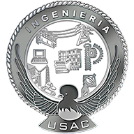

## UNIVERSIDAD DE SAN CARLOS DE GUATEMALA

### FACULTAD DE INGENIERÍA

### ORGANIZACIÓN DE LENGUAJES Y COMPILADORES 2

  

# MANUAL DE USUARIO - TalentMosaic
**Catedrático:** M.Sc. Luis Fernando Espino Barrios

**Auxiliar Laboratorio:** Carlos Fernando Enrique Lopez Garcia

**Grupo:**  32

---
