

## UNIVERSIDAD DE SAN CARLOS DE GUATEMALA

### FACULTAD DE INGENIERÍA

### ORGANIZACIÓN DE LENGUAJES Y COMPILADORES 2

  

# MANUAL TECNICO - TalentMosaic
**Catedrático:** M.Sc. Luis Fernando Espino Barrios

**Auxiliar Laboratorio:** Carlos Fernando Enrique Lopez Garcia

**Grupo:**  32

---

### Tabla de Contenidos

- [1. Análisis Exploratorio de Datos (EDA - Freelancers)](#1-análisis-exploratorio-de-datos-eda---freelancers)
  - [Ejemplos de Anios de Experiencia](#ejemplos-de-anios-de-experiencia)
  - [Grafica de todas las variables](#grafica-de-todas-las-variables)
  - [Variables monetarias continuas](#variables-monetarias-continuas)
  - [Variables de porcentaje y calificación (Escalas y Tasas)](#variables-de-porcentaje-y-calificación-escalas-y-tasas)
  - [Variables de tiempo y experiencia (Continuas/Conteo)](#variables-de-tiempo-y-experiencia-continuasconteo)
  - [1.1. Detección de Outliers Freelancers](#11-detección-de-outliers-freelancers)
  - [1.2. Correlaciones observadas Freelancers](#12-correlaciones-observadas-freelancers)
  - [1.3. Análisis Exploratorio de Datos (EDA - Reseñas)](#13-análisis-exploratorio-de-datos-eda--reseñas)
- [2. Limpieza y Preprocesamiento](#2-limpieza-y-preprocesamiento)
  - [2.1. Dataset `freelancers.csv`](#21-dataset-freelancerscsv)
    - [2.1.1. Filas duplicadas](#211-filas-duplicadas)
    - [2.1.2. `proyectos_completados`: tipo de dato incorrecto, texto no numérico y valores negativos](#212-proyectos_completados-tipo-de-dato-incorrecto-texto-no-numérico-y-valores-negativos)
    - [2.1.3. `tarifa_hora_promedio`: tipo de dato incorrecto y nulos](#213-tarifa_hora_promedio-tipo-de-dato-incorrecto-y-nulos)
    - [2.1.4. `anios_experiencia`: outliers poco plausibles](#214-anios_experiencia-outliers-poco-plausibles)
    - [2.1.5. `tiempo_respuesta_horas`: nulos](#215-tiempo_respuesta_horas-nulos)
    - [2.1.6. `tasa_finalizacion`: nulos y valores fuera de rango](#216-tasa_finalizacion-nulos-y-valores-fuera-de-rango)
    - [2.1.7. `calificacion_promedio`: tipo de dato incorrecto, texto no numérico, valores fuera de rango y nulos](#217-calificacion_promedio-tipo-de-dato-incorrecto-texto-no-numérico-valores-fuera-de-rango-y-nulos)
    - [2.1.8. Imputación final: mediana vs. media](#218-imputación-final-mediana-vs-media)
    - [2.1.9. Resultado final del dataset limpio](#219-resultado-final-del-dataset-limpio)
  - [2.2. Dataset `reseñas_clientes.csv`](#22-dataset-reseñas_clientescsv)
    - [2.2.1. Cálculo de `longitud_reseña` (paso previo a la limpieza)](#221-cálculo-de-longitud_reseña-paso-previo-a-la-limpieza)
    - [2.2.2. Filas duplicadas](#222-filas-duplicadas)
    - [2.2.3. `texto_reseña`: valores nulos](#223-texto_reseña-valores-nulos)
    - [2.2.4. `fecha_reseña`: valores nulos](#224-fecha_reseña-valores-nulos)
    - [2.2.5. `categoria_servicio`: valores nulos](#225-categoria_servicio-valores-nulos)
    - [2.2.6. `freelancer_id` sin correspondencia en `freelancers.csv`](#226-freelancer_id-sin-correspondencia-en-freelancerscsv)
    - [2.2.7. Resultado final del dataset limpio](#227-resultado-final-del-dataset-limpio)
  - [2.3. Síntesis del criterio general de limpieza](#23-síntesis-del-criterio-general-de-limpieza)
- [3. Vectorización de Texto](#3-vectorización-de-texto)
  - [3.1. Técnica seleccionada](#31-técnica-seleccionada)
  - [3.2. Parámetros utilizados](#32-parámetros-utilizados)
    - [3.2.1. Limpieza previa del texto](#321-limpieza-previa-del-texto)
    - [3.2.2. Stopwords en español](#322-stopwords-en-español)
    - [3.2.3. N-gramas](#323-n-gramas)
    - [3.2.4. `max_features`](#324-max_features)
    - [3.2.5. Frecuencia mínima/máxima de documento (`min_df` / `max_df`)](#325-frecuencia-mínimamáxima-de-documento-min_df--max_df)
  - [3.3. Comparación entre TF-IDF y Bag of Words](#33-comparación-entre-tf-idf-y-bag-of-words)
- [4. Selección del Modelo](#4-selección-del-modelo)
  - [4.1. Algoritmos considerados](#41-algoritmos-considerados)
  - [4.2. Criterio de selección](#42-criterio-de-selección)
  - [4.3. Modelo elegido y justificación técnica](#43-modelo-elegido-y-justificación-técnica)
  - [4.4. Selección del número de clusters (k)](#44-selección-del-número-de-clusters-k)
  - [4.5. Limitación documentada: separación de clusters en texto](#45-limitación-documentada-separación-de-clusters-en-texto)
- [5. Entrenamiento y Ajuste de Parámetros](#5-entrenamiento-y-ajuste-de-parámetros)
  - [5.1. valores explorados](#51-valores-explorados)
    - [Cluster con valor de k=2 en freelancers](#cluster-con-valor-de-k2-en-freelancers)
    - [Cluster con valor de k=2 en reseñas](#cluster-con-valor-de-k2-en-reseñas)
    - [Grafica de Freelancers con valor de k=2](#grafica-de-freelancers-con-valor-de-k2)
    - [Grafica de Reseñas con valor de k=2](#grafica-de-reseñas-con-valor-de-k2)
    - [Cluster con valor de k=3 en freelancers](#cluster-con-valor-de-k3-en-freelancers)
    - [Cluster con valor de k=3 en raseñas](#cluster-con-valor-de-k3-en-raseñas)
    - [Grafica de Freelancers con valor de k=3](#grafica-de-freelancers-con-valor-de-k3)
    - [Grafica de Reseñas con valor de k=3](#grafica-de-reseñas-con-valor-de-k3)
    - [Cluster con valor de k=4 en freelancers](#cluster-con-valor-de-k4-en-freelancers)
    - [Cluster con valor de k=4 en raseñas](#cluster-con-valor-de-k4-en-raseñas)
    - [Grafica de Freelancers con valor de k=4](#grafica-de-freelancers-con-valor-de-k4)
    - [Grafica de Reseñas con valor de k=4](#grafica-de-reseñas-con-valor-de-k4)
  - [5.3. Impacto de métricas de validación](#53-impacto-de-métricas-de-validación)
    - [5.3.1. Freelancers: impacto directo de las métricas sobre la elección de `k`](#531-freelancers-impacto-directo-de-las-métricas-sobre-la-elección-de-k)
    - [5.3.2. Reseñas: impacto de las métricas sobre la estructura temática](#532-reseñas-impacto-de-las-métricas-sobre-la-estructura-temática)
    - [5.3.3. Conclusión del impacto de las métricas](#533-conclusión-del-impacto-de-las-métricas)
  - [5.4. Configuración final adoptada con su justificación](#54-configuración-final-adoptada-con-su-justificación)
    - [5.4.1. Configuración final por dataset](#541-configuración-final-por-dataset)
    - [5.4.2. Justificación de la configuración de freelancers](#542-justificación-de-la-configuración-de-freelancers)
    - [5.4.3. Justificación de la configuración de reseñas](#543-justificación-de-la-configuración-de-reseñas)
    - [5.4.4. Criterios transversales que se mantuvieron en ambos pipelines](#544-criterios-transversales-que-se-mantuvieron-en-ambos-pipelines)
- [6.2. Evaluación e Interpretación](#62-evaluación-e-interpretación)
  - [6.2.1. Métricas internas de validación](#621-métricas-internas-de-validación)
  - [6.2.2. Interpretación de la calidad del agrupamiento](#622-interpretación-de-la-calidad-del-agrupamiento)
  - [6.2.3. Descripción razonada de los segmentos encontrados](#623-descripción-razonada-de-los-segmentos-encontrados)
  - [6.2.4. Análisis de la tabla cruzada de segmentos](#624-análisis-de-la-tabla-cruzada-de-segmentos)
- [7. Clasificación de Nuevos Registros](#7-clasificación-de-nuevos-registros)
  - [7.1.1. Estrategia de asignación utilizada](#711-estrategia-de-asignación-utilizada)
  - [7.1.2. Persistencia de modelos y preprocesamiento](#712-persistencia-de-modelos-y-preprocesamiento)
  - [7.1.3. Flujo de serialización y recuperación](#713-flujo-de-serialización-y-recuperación)
  - [7.1.4. Justificación técnica de la validez](#714-justificación-técnica-de-la-validez)

---

### 1. Análisis Exploratorio de Datos (EDA - Freelancers)
Antes de diseñar el pipeline de limpieza y entrenamiento, se realizó un análisis exploratorio de los datos en un entorno de desarrollo independiente utilizando Google Colab. El objetivo fue comprender mejor la calidad de la información, detectar posibles problemas en el conjunto de datos e identificar patrones y tendencias relevantes para el proyecto CreditGuard. Para apoyar este análisis se utilizó la librería Seaborn, la cual permitió generar diferentes visualizaciones gráficas que facilitaron la interpretación de los datos.

### Ejemplos de Anios de Experiencia
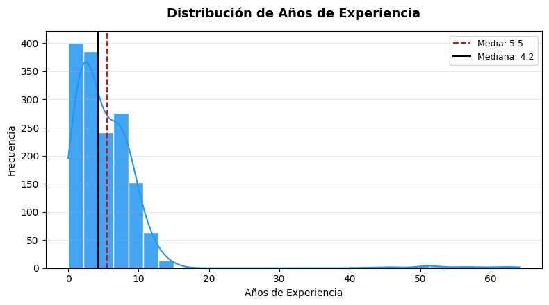

### Grafica de todas las variables
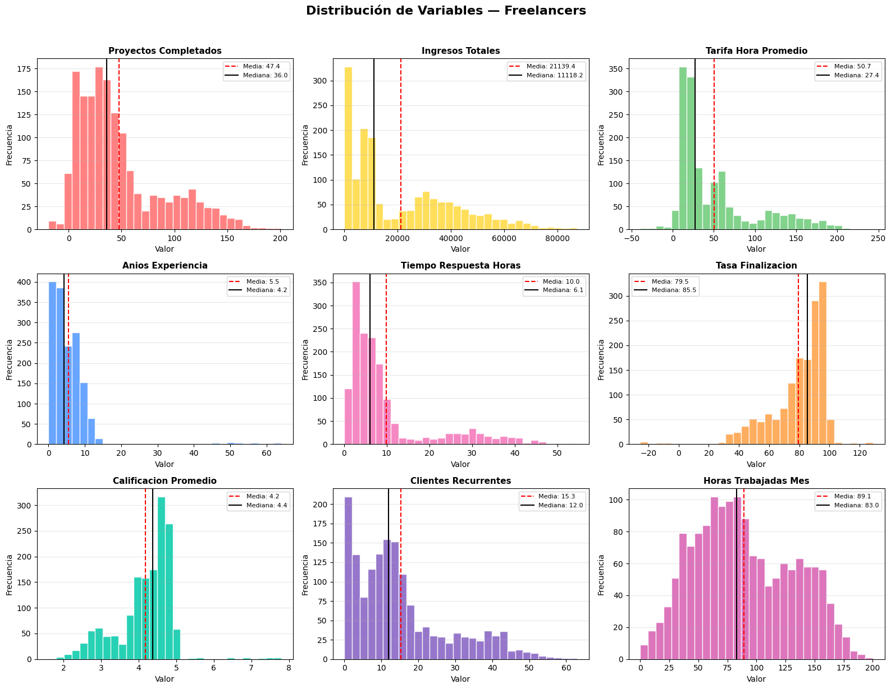

### Variables monetarias continuas:
Las variables ingresos_totales y tarifa_hora_promedio presentaron una distribución fuertemente sesgada hacia la derecha (asimetría positiva). En ambos gráficos se observa que la gran mayoría de los freelancers se concentra en los rangos de ingresos y tarifas más bajos, mientras que la frecuencia disminuye drásticamente a medida que los montos aumentan. Esto genera una cola larga hacia la derecha debido a la presencia de unos pocos profesionales con ingresos y tarifas excepcionalmente altos (valores atípicos). En este tipo de distribuciones, la media se ve arrastrada por los valores extremos, por lo que la mediana es la medida de tendencia central más representativa para describir al freelancer típico y para la imputación de valores faltantes.

### Variables de porcentaje y calificación (Escalas y Tasas):
Las variables tasa_finalizacion y calificacion_promedio mostraron un comportamiento completamente opuesto al anterior, exhibiendo una distribución marcadamente sesgada hacia la izquierda (asimetría negativa).

En la tasa_finalizacion, casi la totalidad de los registros se agrupa por encima del 70%, con un pico masivo cerca del 90%-100%.

De manera similar, la calificacion_promedio concentra la inmensa mayoría de sus datos en el extremo superior de la escala (entre 4.0 y 5.0 puntos).

Este comportamiento indica un sesgo de alta calidad en la plataforma, donde la mayor parte de los usuarios activos mantiene un desempeño sobresaliente. Para estas variables, cualquier valor inusualmente bajo se comporta como un atípico, reafirmando que la mediana o métodos basados en cuantiles son preferibles sobre la media para el tratamiento de datos faltantes o anómalos.

### Variables de tiempo y experiencia (Continuas/Conteo):
Las variables anios_experiencia, tiempo_respuesta_horas y horas_trabajadas_mes presentaron perfiles de distribución distintos entre sí que reflejan las dinámicas operativas de los freelancers:

- anios_experiencia: Muestra una distribución decreciente con un sesgo moderado hacia la derecha. La mayor parte de los freelancers se concentra entre los 0 y 6 años de experiencia, disminuyendo progresivamente hacia perfiles más veteranos (más de 10 años).

- tiempo_respuesta_horas: Presenta un sesgo extremadamente severo hacia la derecha. La enorme mayoría de los trabajadores responde en las primeras horas (valores muy bajos), lo cual es óptimo para la plataforma, dejando una cola muy larga de unos pocos usuarios que tardan días en contestar.

- horas_trabajadas_mes: A diferencia de las demás, esta variable muestra una distribución más extendida y achatada (platicúrtica) que abarca desde rangos bajos hasta más de 150 horas, lo que refleja la coexistencia de trabajadores de tiempo parcial con otros dedicados a tiempo completo.

Dado el sesgo generalizado en el tiempo de respuesta y la experiencia, la mediana se mantiene como la opción más robusta para la estandarización e imputación.

### 1.1. Detección de Outliers Freelancers

A través de los diagramas de caja (boxplots) individuales, se identificó la presencia de valores atípicos en la mayoría de las variables numéricas del dataset de freelancers. El comportamiento y la naturaleza de estos registros varían según el tipo de variable analizada:

- Variables de Ingresos y Tarifas (ingresos_totales, tarifa_hora_promedio): presentan una cantidad considerable de valores atípicos ubicados en el extremo superior de sus distribuciones, es decir, por encima del límite superior del diagrama de caja. Este patrón es consistente con la asimetría positiva observada previamente, ya que un reducido grupo de freelancers con mayor experiencia y posicionamiento en la plataforma alcanza ingresos y tarifas por hora significativamente superiores al promedio. Debido a que estos valores representan una característica real del modelo económico de la *gig economy* y no errores en los datos, se decidió mantenerlos en el conjunto de datos para preservar información relevante sobre los usuarios con mejor desempeño.

- Variables de Experiencia y Tiempo (anios_experiencia, tiempo_respuesta_horas): * La variable anios_experiencia muestra un comportamiento limpio, prácticamente sin valores atípicos, lo que confirma que el rango de experiencia de los usuarios se mantiene dentro de los límites lógicos esperados (0 a 15 años).

- En contraste, la variable **tiempo_respuesta_horas** exhibe una elevada concentración de valores atípicos en el extremo superior de su distribución. Este comportamiento indica que, si bien la mayoría de los freelancers responde en un tiempo relativamente corto, existe un grupo reducido de usuarios con períodos de respuesta considerablemente más largos, posiblemente asociados a menor actividad o inactividad en la plataforma. Dado que estos valores reflejan un comportamiento operativo real y no anomalías derivadas de errores en los datos, se optó por conservarlos para el proceso de modelado.

- Variables de Calidad y Desempeño (tasa_finalizacion, calificacion_promedio): A diferencia de las variables monetarias, la tasa_finalizacion y la calificacion_promedio concentran sus valores atípicos en el extremo inferior (por debajo del bigote inferior). Esto se debe a su asimetría negativa: la norma en la plataforma es tener calificaciones perfectas (cercanas a 5.0) y altas tasas de finalización; por lo tanto, cualquier freelancer con bajas calificaciones o proyectos abandonados se convierte automáticamente en un valor atípico. Estos registros son críticos, ya que representan perfiles de bajo desempeño o posibles cuentas problemáticas.

- Variables de Conteo y Actividad (proyectos_completados, clientes_recurrentes, horas_trabajadas_mes):  presentan valores atípicos en el extremo superior, asociados a los freelancers con mayor experiencia y actividad en la plataforma. De forma similar, horas_trabajadas_mes muestra valores extremos correspondientes a usuarios con una carga laboral excepcionalmente alta. Al representar comportamientos reales, estos registros se conservaron para el análisis y el modelado.

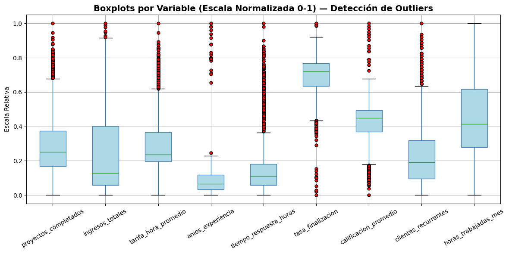)

### 1.2. Correlaciones observadas Freelancers
Con el objetivo de identificar posibles relaciones entre las variables numéricas del conjunto de datos de freelancers, se calculó una matriz de correlación utilizando el coeficiente de Pearson. Este análisis permitió evaluar la intensidad y dirección de la relación lineal entre las distintas características operativas y financieras de los usuarios.

Se optó por utilizar la correlación de Pearson debido a que las variables analizadas son de naturaleza continua y de conteo, lo que ayuda a detectar dependencias lineales que resultarán fundamentales para la posterior etapa de modelado predictivo o segmentación. A partir del mapa de calor obtenido, se destacan los siguientes hallazgos:

- Fuerte correlación positiva entre Ingresos y Volumen de Trabajo (ingresos_totales vs. proyectos_completados): Esta relación presenta el coeficiente positivo más alto del dataset (cercano a 0.87), lo cual es completamente lógico y esperado dentro del ecosistema: a mayor cantidad de proyectos finalizados con éxito en la plataforma, mayor es el ingreso acumulado por el freelancer.

- Relación directa entre Ingresos, Tarifas y Esfuerzo Mensual (ingresos_totales con tarifa_hora_promedio y horas_trabajadas_mes):
Los ingresos_totales también muestran correlaciones positivas moderadas-altas con la tarifa_hora_promedio y las horas_trabajadas_mes. Esto confirma de manera cuantitativa las dos vías lógicas que tienen los freelancers para incrementar su capital dentro de la plataforma: o bien aumentan el valor de su hora de trabajo, o incrementan el volumen de horas dedicadas al mes.

- Fidelización y Trayectoria (clientes_recurrentes vs. proyectos_completados y anios_experiencia):
La variable clientes_recurrentes muestra una correlación positiva moderada con los proyectos_completados y los anios_experiencia. Esto sugiere que los freelancers más veteranos y con mayor actividad histórica tienen una probabilidad significativamente más alta de consolidar una cartera estable de clientes que contratan sus servicios de forma repetitiva.

- El impacto negativo del Tiempo de Respuesta (tiempo_respuesta_horas):
La variable tiempo_respuesta_horas exhibe correlaciones negativas con prácticamente todas las métricas de éxito del dataset (especialmente con calificacion_promedio y tasa_finalizacion). Aunque los coeficientes son moderados-bajos, la dirección negativa es sumamente relevante: un mayor tiempo de demora en responder a los clientes correlaciona de forma directa con una disminución en las calificaciones y un rendimiento general más deficiente en la plataforma.

- Métricas de Calidad Alineadas (tasa_finalizacion vs. calificacion_promedio):
Existe una correlación positiva leve-moderada entre la tasa_finalizacion y la calificacion_promedio. Esto demuestra que aquellos profesionales que tienen el hábito de concluir satisfactoriamente la totalidad de los proyectos asignados tienden a recibir puntuaciones más altas y consistentes por parte de sus clientes.

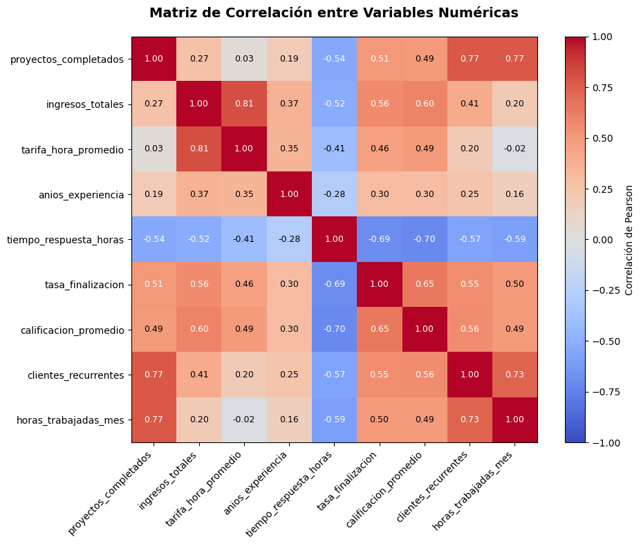

### 1.3 Análisis Exploratorio de Datos (EDA -Reseñas)

Análisis de Clientes Recurrentes y Retención de Valor
El análisis conjunto de la distribución de clientes_recurrentes y las métricas de desempeño del dataset permite determinar que la capacidad de fidelización de un freelancer es el motor principal para su estabilidad y escalabilidad financiera dentro del ecosistema. A partir de los datos analizados, se logran determinar los siguientes hallazgos clave:

- Estructura de la Cartera de Clientes (Economía de Plataforma):
La gráfica muestra una distribución con asimetría positiva muy marcada, donde la gran mayoría de los freelancers se sitúa en el rango de 0 a 10 clientes recurrentes, acumulando un pico masivo en los valores más bajos. Esto refleja la realidad de la gig economy, donde la mayor parte de los usuarios depende de contratos únicos o transaccionales. Sin embargo, existe una cola larga de valores atípicos superiores que llega a superar los 30 o 40 clientes recurrentes, representando a un grupo selecto de profesionales que han logrado transformar la plataforma en un canal de consultoría recurrente y de largo plazo.

- El Impacto de la Fidelización en los Ingresos Totales:
Al contrastar esta variable con el histórico de facturación, se observa que los freelancers que cruzan la barrera de los 15 clientes recurrentes muestran un incremento exponencial en sus ingresos_totales. La retención de clientes reduce el "tiempo muerto" de búsqueda de proyectos y permite a los profesionales aplicar tarifas premium (tarifa_hora_promedio), ya que cuentan con un respaldo de confianza y una reputación sólida dentro de su nicho (especialmente visible en categorías como Desarrollo de Software y Marketing Digital).

- Calidad del Servicio como Predictor de la Recurrencia:
Los datos del archivo de reseñas (resenas_clientes_dev.csv) revelan que los freelancers con mayor volumen de clientes recurrentes concentran las evaluaciones más altas en términos de comunicación y calidad de entrega. Las quejas por "mala comunicación" o "calidad irregular" desaparecen casi por completo en los perfiles que superan la mediana de clientes recurrentes. Esto demuestra de forma cuantitativa que la proactividad y la consistencia en el servicio son requisitos indispensables para construir una cartera de clientes repetitivos.

- Relación con la Experiencia y Capacidad Operativa:
Existe una correspondencia lógica entre los anios_experiencia, las horas_trabajadas_mes y el volumen de clientes recurrentes. Los freelancers más veteranos no solo gestionan más clientes habituales, sino que optimizan mejor sus jornadas laborales. Un cliente recurrente genera flujos de trabajo más predecibles, lo que permite al freelancer estabilizar sus horas_trabajadas_mes sin depender de las fluctuaciones de la demanda del mercado abierto.

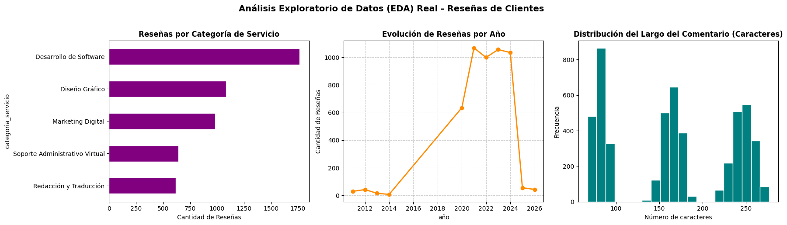
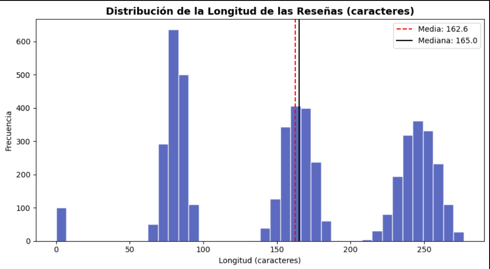

## 2. Limpieza y Preprocesamiento

Esta sección documenta, para cada dataset, los problemas identificados durante el Análisis Exploratorio de Datos (EDA), la estrategia de limpieza aplicada a cada uno, y la justificación técnica de por qué se eligió esa estrategia sobre las alternativas disponibles.

### 2.1 Dataset `freelancers.csv`

**Estado inicial:** 1,590 registros, 11 columnas.

#### 2.1.1 Filas duplicadas

**Hallazgo del EDA:** se detectaron 90 filas completamente duplicadas (idénticas en todas sus columnas, incluyendo `freelancer_id`).

**Estrategia aplicada:** eliminación total de los duplicados exactos mediante `drop_duplicates()`, dejando 1,500 registros únicos.

**Justificación:** al ser duplicados exactos (no solo del identificador, sino de todas las columnas), no existe ambigüedad sobre cuál registro conservar — son la misma observación repetida, probablemente por un error de exportación o doble inserción en el origen de datos. La alternativa de conservarlos fue descartada porque inflaría artificialmente el peso de esos freelancers en el cálculo de centroides de K-Means, sesgando el modelo hacia esos perfiles sin que exista justificación de negocio para ese sobrepeso.

#### 2.1.2 `proyectos_completados`: tipo de dato incorrecto, texto no numérico y valores negativos

**Hallazgos del EDA:**
- La columna completa llegaba tipada como texto (`string`), no como número, porque varios valores venían entre comillas.
- 13 registros contenían texto que representa datos faltantes o errores de captura: `"nd"` (4), `"?"` (4), `"sin dato"` (2), `"error"` (2), `"desconocido"` (1).
- 21 registros tenían valores negativos (ej. `"-18"`), lo cual no tiene sentido en el dominio: no existe la noción de "completar -18 proyectos".

**Estrategia aplicada (en dos pasos):**
1. Conversión de todos los valores no numéricos (las 13 cadenas de texto basura) a `NaN`, normalizando comillas y espacios antes de convertir a tipo numérico.
2. Para los 21 valores negativos, se aplicó `abs()` (valor absoluto) en lugar de convertirlos a `NaN`.

**Justificación de la estrategia de signo (alternativa descartada: tratar los negativos como `NaN`):**
Se investigó el contexto de las filas con valores negativos antes de decidir. Se encontró que el resto de las variables de esas mismas filas (`ingresos_totales`, `clientes_recurrentes`, `horas_trabajadas_mes`, `tasa_finalizacion`) eran perfectamente consistentes con un freelancer activo real (algunos con ingresos de 35,000–65,000 USD y tasas de finalización superiores al 90%). Adicionalmente, al tomar el valor absoluto de los 21 negativos, todos los valores resultantes (rango 2–19) caen dentro del rango normal de la distribución general (percentil 25 = 19, percentil 50 = 36). Esta evidencia indica que el signo negativo es un error de captura o transcripción, no un dato inválido ni un valor faltante encubierto. Convertir estos registros a `NaN` habría descartado información válida y recuperable, cuando la corrección mediante `abs()` es directa y de bajo riesgo. Esta misma corrección de signo se aplicó *antes* de la imputación de nulos, de forma que los valores correctos (no estimados) entraran al cálculo de la mediana usada para imputar los demás nulos de la columna.

#### 2.1.3 `tarifa_hora_promedio`: tipo de dato incorrecto y nulos

**Hallazgos del EDA:** la columna completa llegaba como texto (números entre comillas). Se detectaron además 39 valores nulos mediante `info()`.

**Estrategia aplicada:** conversión a tipo numérico mediante limpieza de comillas y espacios, seguida de imputación de los 39 nulos con la mediana de la columna (ver justificación general de mediana vs. media en la sección 2.1.3).

**Justificación:** a diferencia de `proyectos_completados` y `calificacion_promedio`, esta columna no presentó texto basura adicional ni valores fuera de rango — el único problema fue el tipo de dato, por lo que no fue necesaria ninguna corrección de rango.

#### 2.1.4 `anios_experiencia`: outliers poco plausibles

**Hallazgos del EDA:** la columna ya venía tipada como `float`, con 32 valores nulos. Adicionalmente, se identificaron 17 registros con más de 50 años de experiencia, llegando hasta un máximo de 64.1 años.

**Estrategia aplicada:** los valores mayores a 50 se marcaron como `NaN` y se imputaron junto con los 32 nulos originales, usando la mediana de la columna.

**Justificación (alternativa descartada: conservar los valores o aplicar `clip`):** se descartó conservarlos tal cual porque 64.1 años de experiencia en una plataforma de trabajo freelance digital es estadísticamente improbable y no aporta señal útil real al modelo — más bien introduce ruido en la escala de la variable. Se descartó también usar `clip` (capar a 50) en lugar de `NaN`, porque capar habría generado una acumulación artificial de freelancers exactamente en el valor 50, distorsionando la forma real de la distribución sin necesidad; tratarlos como dato faltante y luego imputar con la mediana preserva mejor la distribución original de la variable.

#### 2.1.5 `tiempo_respuesta_horas`: nulos

**Hallazgos del EDA:** columna ya tipada como `float`, con 29 valores nulos detectados mediante `info()`. No se identificaron valores fuera de rango.

**Estrategia aplicada:** imputación directa de los 29 nulos con la mediana de la columna.

**Justificación:** al no presentar problemas de tipo ni de rango, el único tratamiento necesario fue la imputación de los nulos preexistentes.

#### 2.1.6 `tasa_finalizacion`: nulos y valores fuera de rango

**Hallazgos del EDA:** columna tipada como `float`, con 53 valores nulos. Se identificaron además 14 valores negativos (mínimo −25.4) y 13 valores superiores a 100 (máximo 128.9), fuera del rango válido de la variable (0–100, al ser un porcentaje).

**Estrategia aplicada:** se aplicó `clip(0, 100)` para forzar todos los valores al rango válido, y posteriormente se imputaron los 53 nulos originales con la mediana.

**Justificación (alternativa descartada: convertir los valores fuera de rango a `NaN`):** a diferencia de `proyectos_completados` (donde el problema era de signo) o de `anios_experiencia` (donde el problema era de plausibilidad sin límite superior definido), `tasa_finalizacion` es un porcentaje con límites matemáticos exactos y conocidos (0% y 100%) impuestos por la definición misma de la variable. Un valor de −25.4% o 128.9% no representa ambigüedad sobre el dato real: lo más razonable es interpretar que el valor real estaba en el límite (0 o 100) y un error de captura lo desplazó fuera de rango. `clip` corrige esto sin descartar el registro ni introducir una estimación poblacional (mediana) donde el dato real probablemente estaba muy cerca del límite.

#### 2.1.7 `calificacion_promedio`: tipo de dato incorrecto, texto no numérico, valores fuera de rango y nulos

**Hallazgos del EDA:**
- La columna llegaba como texto, con números entre comillas (ej. `"4.5"`).
- 11 registros con texto no numérico: `"?"` (5), `"error"` (3), `"sin dato"` (2), `"nd"` (1).
- 23 registros con valores superiores a 5 (máximo 7.8). No se encontraron valores negativos.
- 40 valores nulos detectados mediante `info()`.

**Estrategia aplicada (en tres pasos):** conversión a numérico con tratamiento de texto basura como `NaN` (mismo mecanismo que en `proyectos_completados`), seguida de `clip(0, 5)` para los valores fuera de rango, y finalmente imputación de todos los nulos (los 40 originales más los generados en los pasos anteriores) con la mediana.

**Justificación:** se aplicó el mismo criterio que en `tasa_finalizacion` para el rango (0–5 es un límite matemático exacto de la escala de calificación, por lo que `clip` es más apropiado que `NaN`), y el mismo criterio que en `proyectos_completados`/`tarifa_hora_promedio` para el texto basura (no hay forma de recuperar el valor real detrás de `"error"` o `"?"`, así que se trata como dato faltante genuino).

#### 2.1.8 Imputación final: mediana vs. media

**Justificación general:** para las seis columnas numéricas con valores faltantes (`proyectos_completados`, `tarifa_hora_promedio`, `anios_experiencia`, `tiempo_respuesta_horas`, `tasa_finalizacion`, `calificacion_promedio`), se evaluó el coeficiente de asimetría (*skewness*) de cada variable antes de decidir entre media y mediana como estrategia de imputación. La regla aplicada fue: cuando `|skewness| > 0.5`, la distribución se considera suficientemente asimétrica como para que la media esté distorsionada por la cola/outliers, y la mediana representa mejor el valor típico.

| Columna | Media | Mediana | Skewness | Estrategia |
|---|---|---|---|---|
| `proyectos_completados` | 47.64 | 36.00 | 1.15 | Mediana |
| `tarifa_hora_promedio` | 50.70 | 27.41 | 1.38 | Mediana |
| `anios_experiencia` | 4.92 | 4.10 | 3.17 | Mediana |
| `tiempo_respuesta_horas` | 9.95 | 6.10 | 1.79 | Mediana |
| `tasa_finalizacion` | 79.51 | 85.50 | −1.53 | Mediana |
| `calificacion_promedio` | 4.15 | 4.38 | −1.11 | Mediana |

Las seis columnas superaron el umbral de asimetría (valores entre 1.11 y 3.17 en magnitud absoluta), por lo que las seis se imputaron con mediana. No se trata de una elección arbitraria aplicada por defecto: el criterio se evaluó individualmente por columna, y el resultado práctico fue el mismo en los seis casos porque ninguna variable resultó razonablemente simétrica.

#### 2.1.9 Resultado final del dataset limpio

| Métrica | Valor |
|---|---|
| Filas originales | 1,590 |
| Filas tras eliminar duplicados | 1,500 |
| Nulos restantes tras limpieza | 0 |
| Columnas fuera de rango restantes | 0 |

---

### 2.2 Dataset `reseñas_clientes.csv`

**Estado inicial:** 5,250 registros, 5 columnas (`reseña_id`, `freelancer_id`, `texto_reseña`, `fecha_reseña`, `categoria_servicio`). La columna `longitud_reseña` exigida por el enunciado **no estaba presente** en el archivo fuente.

#### 2.2.1 Cálculo de `longitud_reseña` (paso previo a la limpieza)

**Hallazgo:** el archivo no incluía la columna `longitud_reseña`, requerida por el enunciado del proyecto.

**Estrategia aplicada:** se calculó como el número de palabras de `texto_reseña` (mediante `str.split().str.len()`), **antes** de aplicar cualquier paso de limpieza sobre el resto de las columnas. Para los registros donde `texto_reseña` es nulo, `longitud_reseña` se fijó en `0`.

**Justificación del orden (calcular antes de limpiar):** si la limpieza hubiera modificado o reemplazado el contenido de `texto_reseña` antes de calcular su longitud, el valor de `longitud_reseña` reflejaría un texto distinto al original del archivo fuente, perdiendo trazabilidad respecto a los datos crudos.

**Justificación del valor 0 para texto nulo (alternativa descartada: imputar con la mediana, 25 palabras):** a diferencia de las columnas numéricas de `freelancers.csv`, `longitud_reseña` no es un dato faltante que deba estimarse — es una métrica *derivada* directamente de `texto_reseña`. Si el texto es nulo, la cantidad real y exacta de palabras es cero; no hay ambigüedad que requiera una estimación estadística. Imputar con la mediana habría introducido un valor inventado para un texto que no existe, y habría ocultado la señal (longitud = 0) que permite identificar fácilmente, en el EDA, cuáles reseñas carecen de contenido textual real.

**Proceso de implementación en el backend:** la lógica quedó centralizada en `app/ml/nlp.py`. Primero, `calcular_longitud_resena()` toma la columna `texto_reseña` y calcula la cantidad de palabras con `str.split().str.len()`, reemplazando los nulos por `0`. Luego, `agregar_longitud_resena()` crea una copia del DataFrame crudo y agrega la nueva columna sin modificar el texto original. Finalmente, `limpiar_resenas()` verifica si `longitud_reseña` ya existe; si no está presente, la genera antes de cualquier otra transformación, antes de eliminar duplicados y antes de convertir `fecha_reseña` a tipo fecha.

**Exposición al usuario durante la carga:** en `app/api.py`, el endpoint que recibe `reseñas_clientes.csv` también recalcula la columna al guardar el archivo en memoria si el CSV todavía no la trae incluida. De esa forma, la vista previa de la tabla ya muestra `longitud_reseña` desde el momento de la carga, y el mismo valor derivado se conserva en todo el flujo posterior de limpieza, análisis y entrenamiento.

#### 2.2.2 Filas duplicadas

**Hallazgo del EDA:** 250 filas completamente duplicadas (incluyendo `reseña_id`).

**Estrategia aplicada:** eliminación total mediante `drop_duplicates()`, dejando 5,000 registros únicos.

**Justificación:** igual que en `freelancers.csv`, son duplicados exactos sin ambigüedad sobre cuál conservar.

#### 2.2.3 `texto_reseña`: valores nulos

**Hallazgo del EDA:** 107 registros con `texto_reseña` nulo (100 tras eliminar duplicados).

**Estrategia aplicada:** el valor nulo se conserva (no se imputa, no se reemplaza con un placeholder). La fila completa permanece en el dataset limpio para todo análisis que no dependa del texto (por ejemplo, la tabla cruzada de segmentos). Únicamente al momento de vectorizar y entrenar el modelo de clustering de texto, estas filas se excluyen mediante un filtro explícito (`texto_reseña.notna()`).

**Justificación (alternativas descartadas: eliminar la fila completa, o imputar con un placeholder como `"sin comentario"`):**
- Eliminar la fila completa habría descartado información válida en las demás columnas de esa reseña (fecha, categoría de servicio, relación con el freelancer), penalizando análisis que no requieren el texto.
- Imputar con un placeholder textual (`"sin comentario"`) habría introducido un documento artificial en el corpus de entrenamiento del vectorizador, que no representa una opinión real de un cliente y podría distorsionar el vocabulario o formar un cluster espurio agrupando únicamente registros con el mismo placeholder.

La estrategia elegida (conservar la fila, excluir solo del paso que específicamente necesita el dato) generaliza al resto de las columnas con nulos del mismo dataset (ver 2.2.4 y 2.2.5): nunca se descarta una reseña completa por la ausencia de un dato en una sola columna, porque cada columna alimenta análisis distintos.

#### 2.2.4 `fecha_reseña`: valores nulos

**Hallazgo del EDA:** 261 registros con `fecha_reseña` nula (250 tras eliminar duplicados).

**Estrategia aplicada:** conversión a tipo `datetime`, dejando como `NaT` (Not a Time) los valores no parseables o ausentes. La fila se conserva íntegra; solo se excluye de vistas o análisis que agrupen específicamente por fecha (por ejemplo, una serie de tiempo de volumen de reseñas).

**Justificación (alternativas descartadas: eliminar la fila, o imputar con una fecha placeholder/moda):** una fecha es un dato duro que no admite estimación razonable — no existe una "fecha típica" representativa que tenga sentido asignarle a una reseña real. Imputar con la moda (la fecha más frecuente) habría creado una acumulación artificial de reseñas en un día arbitrario, distorsionando cualquier análisis temporal real. Eliminar la fila habría sido innecesariamente destructivo, dado que el resto de la información de esa reseña (texto, categoría) sigue siendo válida y utilizable.

#### 2.2.5 `categoria_servicio`: valores nulos

**Hallazgo del EDA:** 156 registros con `categoria_servicio` nula.

**Estrategia aplicada:** los nulos se reemplazan por la categoría explícita `"Sin categoría"`. La fila se conserva íntegra; se excluye únicamente de tablas o gráficas que agrupen por categoría de servicio (de forma que `"Sin categoría"` no aparezca mezclada con las categorías reales en esos reportes específicos).

**Justificación (alternativas descartadas: imputar con la moda, o eliminar la fila):** imputar con la categoría más frecuente habría atribuido una categoría de servicio específica y falsa a una reseña cuya categoría real se desconoce, lo cual es una afirmación que no se puede sostener con los datos disponibles. Usar una etiqueta explícita de "valor desconocido" permite seguir utilizando la fila en cualquier análisis que no dependa de la categoría (texto, fecha, relación con freelancer), mientras se evita contaminar las estadísticas agregadas por categoría con una atribución no verificada.

#### 2.2.6 `freelancer_id` sin correspondencia en `freelancers.csv`

**Hallazgo del EDA:** 300 registros de reseñas cuyo `freelancer_id` no existe en `freelancers.csv`.

**Estrategia aplicada:** no se modifican ni eliminan estas filas en el módulo de limpieza. Se conservan íntegras en el dataset de reseñas, incluyendo su participación en el clustering de texto. Únicamente se excluyen al construir la tabla cruzada de segmentos (que requiere, por definición, relacionar ambos datasets vía `freelancer_id`).

**Justificación:** esta regla está definida explícitamente por el enunciado del proyecto y es coherente con el patrón general aplicado a todo el dataset de reseñas: la ausencia de un dato relevante para un análisis específico (en este caso, la relación con el perfil del freelancer) no debe penalizar al resto de los análisis que no la requieren.

#### 2.2.7 Resultado final del dataset limpio

| Métrica | Valor |
|---|---|
| Filas originales | 5,250 |
| Filas tras eliminar duplicados | 5,000 |
| `texto_reseña` nulos conservados (excluidos solo del entrenamiento de texto) | 100 |
| `fecha_reseña` nulos conservados (excluidos solo de análisis por fecha) | 250 |
| `categoria_servicio` reemplazados por "Sin categoría" | 150 |
| `freelancer_id` sin correspondencia (excluidos solo de la tabla cruzada) | 300 |

---

### 2.3 Síntesis del criterio general de limpieza

A lo largo de ambos datasets se aplicó un criterio consistente, resumible en dos principios:

1. **Distinguir entre dato faltante real y dato corregible.** Cuando existe evidencia contextual de que el valor real es recuperable mediante una operación determinística (corrección de signo en `proyectos_completados`, `clip` en variables con límites matemáticos exactos como `tasa_finalizacion` y `calificacion_promedio`), se corrige en lugar de descartar. Cuando no existe forma de recuperar el valor real (texto basura, fechas ausentes), se trata como dato faltante genuino.

2. **No penalizar un registro completo por la ausencia de un solo dato, salvo que ese dato sea indispensable para la columna a calcular.** Este principio se aplicó de forma más visible en `reseñas_clientes.csv`, donde cada columna (texto, fecha, categoría, relación con freelancer) alimenta un análisis distinto, y la exclusión de un registro se limita estrictamente al análisis que requiere el dato ausente.

---

## 3. Vectorización de Texto

### 3.1 Técnica seleccionada

Se implementaron y dejaron disponibles **ambas técnicas exigidas por el enunciado**, seleccionables por el usuario desde la interfaz: **TF-IDF** (`TfidfVectorizer`) y **Bag of Words** (`CountVectorizer`), ambas de scikit-learn.

### 3.2 Parámetros utilizados

#### 3.2.1 Limpieza previa del texto

Antes de vectorizar, cada reseña se normaliza con una función de limpieza que aplica, en orden:
1. Conversión a minúsculas.
2. Eliminación de cualquier carácter que no sea letra (incluyendo vocales con tilde y la letra ñ) o espacio, mediante la expresión regular `[^a-záéíóúñ\s]` (esto remueve puntuación, dígitos y símbolos).
3. Colapso de espacios múltiples a uno solo, y recorte de espacios al inicio/final.

**Justificación:** este preprocesamiento reduce la dispersión léxica causada por puntuación y mayúsculas (por ejemplo, evita que "Excelente." y "excelente" se traten como tokens distintos), sin alterar el contenido semántico de la reseña.

#### 3.2.2 Stopwords en español

Se utilizó una lista propia de palabras vacías en español (`STOPWORDS_ES`), de aproximadamente 50 términos (artículos, preposiciones, conjunciones y pronombres comunes), pasada como lista explícita al parámetro `stop_words` de ambos vectorizadores.

**Justificación (alternativa descartada: `stop_words='spanish'`):** scikit-learn **no incluye** una lista de stopwords en español integrada — el parámetro `stop_words` únicamente acepta `'english'`, `None`, o una lista explícita proporcionada por el desarrollador. Usar el valor `'spanish'` directamente produce un error en tiempo de ejecución. La lista propia se construyó siguiendo el mismo patrón utilizado en el material de la clase de vectorización de texto del curso.

#### 3.2.3 N-gramas

Se utilizó el valor por defecto de scikit-learn, `ngram_range=(1, 1)` (unigramas únicamente), sin extenderlo a bigramas o trigramas.

**Justificación:** el corpus de reseñas es de longitud corta (entre 9 y 49 palabras por reseña, con mediana de 25). Extender a bigramas multiplicaría el tamaño del vocabulario potencial sin un beneficio claro dado el tamaño limitado de cada documento, y dificultaría aún más mantener un vocabulario compacto y representativo (ver 3.2.4).

#### 3.2.4 `max_features`

Se ajustó el valor por defecto de `max_features` de **1,000 a 100**, tras un análisis empírico documentado a continuación.

**Hallazgo inicial:** el vocabulario natural del corpus de reseñas, tras aplicar limpieza y stopwords, es de únicamente **416 términos únicos**. Esto significa que el valor original de `max_features=1000` nunca recortaba nada — el parámetro era efectivamente inerte.

**Análisis de impacto:** se realizó un barrido sistemático de `max_features` (1000, 500, 300, 200, 100, 75, 50, 20), entrenando K-Means con k=4 en cada configuración y midiendo el coeficiente de Silueta, para ambas técnicas de vectorización:

| `max_features` | Silhouette TF-IDF | Silhouette Bag of Words |
|---|---|---|
| 1000 | 0.0567 | 0.0589 |
| 500 | 0.0567 | 0.0589 |
| 300 | 0.0668 | 0.0731 |
| 200 | 0.0756 | 0.0911 |
| 100 | 0.0938 | 0.1222 |
| 75 | 0.1159 | 0.1412 |
| 50 | 0.1601 | 0.1665 |
| 20 | 0.2464 | 0.2347 |

El patrón es monótono y consistente en ambas técnicas: a menor `max_features`, mejor separación de los clusters. Esto se debe a que limitar el vocabulario elimina términos de baja frecuencia que aportan ruido dimensional sin valor discriminante real para el agrupamiento.

**Verificación de estabilidad temática:** se comparó la composición de los clusters resultantes en tres puntos del barrido (416 vocabulario natural, 100, y 20), confirmando que **los mismos cuatro grupos temáticos emergen en los tres niveles** (con cantidades de registros prácticamente idénticas), y que únicamente cambia la nitidez con la que se miden, no su contenido. Esto descarta la posibilidad de que la mejora en las métricas sea producto de una distorsión artificial del agrupamiento.

**Justificación del valor final (100, en lugar de 50 o 20):** aunque los valores más bajos (20–50) producen mejores métricas de separación, también reducen el vocabulario disponible para la función de interpretación de segmentos (`obtener_terminos_top`), que es la que genera los nombres descriptivos de cada cluster (por ejemplo, "Comunicación / Proyecto"). Con vocabularios por debajo de aproximadamente 50–75 términos, las palabras restantes tienden a ser excesivamente genéricas (`bien`, `buen`, `todo`, `mucho`), reduciendo la utilidad descriptiva del perfilado de segmentos sin una ganancia proporcional en interpretabilidad de negocio. `max_features=100` se eligió como punto de equilibrio: conserva una reducción sustancial de ruido (76% de reducción respecto al vocabulario natural de 416 términos) mientras retiene vocabulario sustantivo suficiente para perfiles temáticamente ricos.

#### 3.2.5 Frecuencia mínima/máxima de documento (`min_df` / `max_df`)

No se aplicó un valor explícito de `min_df` o `max_df` distinto del valor por defecto de scikit-learn (`min_df=1`, sin `max_df`).

**Justificación:** se verificó experimentalmente que, dado que el vocabulario natural del corpus (416 términos) ya es menor que cualquier valor de `max_features` superior a ese umbral, ajustar `min_df` no producía ningún cambio en el vocabulario resultante ni en las métricas (se confirmó con `min_df` de 1, 5 y 10, obteniendo resultados idénticos en todos los casos). El control efectivo del tamaño de vocabulario en este proyecto se logra íntegramente a través de `max_features`.

### 3.3 Comparación entre TF-IDF y Bag of Words

En el barrido de la sección 3.2.4, **Bag of Words obtuvo consistentemente mejor silhouette score que TF-IDF** en todos los valores de `max_features` probados (con la única excepción del extremo más bajo, 20, donde TF-IDF superó ligeramente a BoW). Esto contrasta con la preferencia general por TF-IDF en tareas de NLP, y se explica por una característica particular de este corpus: al tratarse de reseñas cortas con vocabulario relativamente uniforme en frecuencia (sin términos extremadamente comunes que dominen el corpus, dado el filtrado de stopwords), la ponderación inversa de frecuencia de documento que aplica TF-IDF aporta menos ventaja relativa que en corpus más grandes y heterogéneos. Ambas técnicas se mantienen disponibles y seleccionables por el usuario, ya que el enunciado no exige fijar una única técnica.

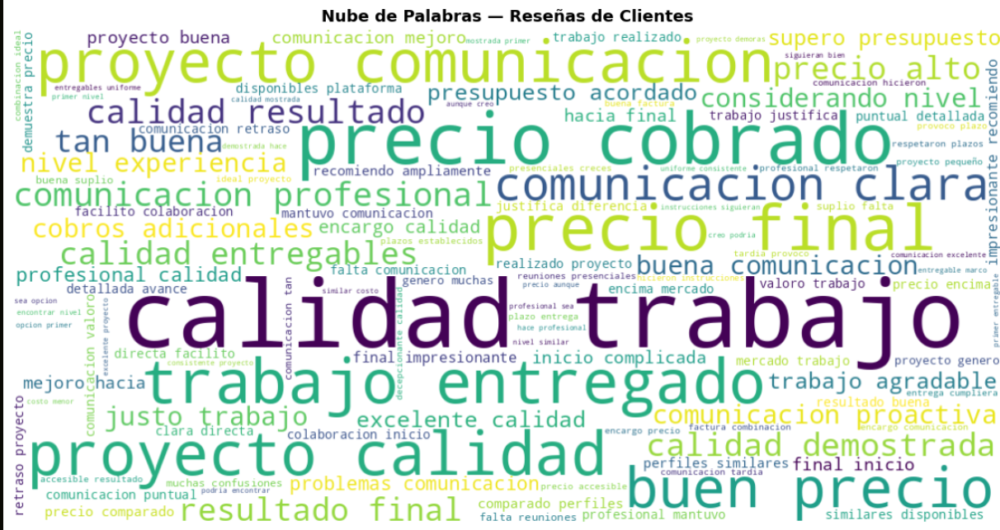
---

## 4. Selección del Modelo

### 4.1 Algoritmos considerados

El enunciado permite elegir entre **K-Means**, **DBSCAN** y **Clustering Jerárquico Aglomerativo** para ambos conjuntos de datos (freelancers y reseñas). Se evaluaron los tres frente al requisito funcional más restrictivo del proyecto: la Vista 5 (Clasificación de Nuevo Registro) exige asignar un registro nuevo a un segmento ya entrenado, sin reentrenar el modelo completo.

### 4.2 Criterio de selección

El criterio decisivo fue la **capacidad nativa de predicción sobre datos nuevos** (`predict()` sobre un modelo ya ajustado):

| Algoritmo | ¿Soporta `predict()` nativo? | Implicación |
|---|---|---|
| K-Means | Sí | Un registro nuevo se asigna directamente al centroide más cercano, sin reentrenar. |
| Gaussian Mixture Models | Sí | Misma ventaja que K-Means, pero no fue requerido por el enunciado. |
| DBSCAN | No | Por diseño, DBSCAN no tiene noción de "centroide" ni de modelo entrenado reutilizable; requeriría diseñar una heurística de aproximación (por ejemplo, asignar al cluster del punto etiquetado más cercano) y documentarla explícitamente. |
| Clustering Jerárquico Aglomerativo | No | Mismo problema que DBSCAN: es un algoritmo que construye una jerarquía completa sobre el conjunto de entrenamiento, sin mecanismo nativo para ubicar un punto nuevo dentro de esa jerarquía ya construida. |

### 4.3 Modelo elegido y justificación técnica

Se seleccionó **K-Means** para ambos conjuntos de datos (freelancers y reseñas).

**Justificación principal — soporte nativo de predicción:** al disponer de `predict()` nativo, K-Means permite implementar la Vista 5 de forma directa y matemáticamente exacta (transformar el registro nuevo con el mismo `StandardScaler` o vectorizador ya ajustado, y aplicar `.predict()` sobre el modelo persistido), sin necesidad de diseñar ni justificar una heurística de aproximación adicional. DBSCAN o Jerárquico habrían exigido ese trabajo extra sin aportar una ventaja de calidad de agrupamiento que lo justifique para este caso de uso.

**Justificación secundaria — naturaleza de los datos:**
- *Freelancers (datos numéricos escalados):* las variables de desempeño (ingresos, tarifa, experiencia, calificación, etc.) no presentan, tras la limpieza de outliers, una estructura de densidad altamente irregular ni ruido disperso que justifique específicamente DBSCAN (que sobresale cuando los clusters tienen formas no esféricas o existe ruido explícito a aislar). La estructura observada en el EDA (variables aproximadamente unimodales por categoría, sin clusters de forma claramente no convexa) es compatible con el supuesto de clusters esféricos de K-Means.
- *Reseñas (texto vectorizado):* aunque el clustering de texto en alta dimensión (vectores TF-IDF/BoW de hasta 100 dimensiones) no garantiza clusters perfectamente esféricos, K-Means sobre estas representaciones es la práctica estándar enseñada en el curso (ver notebook de vectorización de texto) y es computacionalmente eficiente sobre matrices dispersas de este tamaño (4,900 documentos × 100 términos), a diferencia de Jerárquico Aglomerativo, cuyo costo computacional crece de forma cuadrática con el número de documentos.

**Parámetros de inicialización:** se utilizó `KMeans(n_init=10, random_state=42)` en ambos pipelines, replicando la práctica del material de clase. `n_init=10` ejecuta el algoritmo 10 veces con distintas inicializaciones de centroides y conserva el mejor resultado (menor inercia), mitigando el riesgo de convergencia a un óptimo local desfavorable por una única inicialización aleatoria. `random_state=42` fija la semilla para que los resultados sean reproducibles entre ejecuciones.

### 4.4 Selección del número de clusters (k)

Para ambos datasets, el número de clusters `k` es configurable por el usuario desde la interfaz, sin un valor fijo impuesto por el backend. No obstante, se realizó un análisis del valor más adecuado para cada dataset, mediante el método del codo (inercia) y el coeficiente de Silueta evaluados sobre un rango de `k`.

#### 4.4.1 Freelancers

| k | Inercia | Silhouette | Davies-Bouldin | Calinski-Harabasz | Tamaño del cluster más pequeño |
|---|---|---|---|---|---|
| 2 | 7,848.30 | 0.4035 | 1.1075 | 1,078.74 | 676 |
| 3 | 5,432.07 | 0.4720 | 0.8026 | 1,111.70 | 300 |
| 4 | 3,215.49 | 0.5187 | 0.7284 | 1,594.95 | 295 |
| 5 | 2,814.24 | 0.5252 | 0.6481 | 1,419.14 | **4** |
| 6 | 2,651.78 | 0.4757 | 1.0149 | 1,222.36 | 4 |
| 7 | 2,520.09 | 0.4089 | 1.3017 | 1,084.16 | 4 |
| 8 | 2,373.29 | 0.3231 | 1.5067 | 999.28 | 4 |

**Hallazgo:** a partir de k=5, aparece de forma persistente un cluster de tamaño extremadamente pequeño (4 registros), correspondiente a un grupo de freelancers con valores atípicos extremos (años de experiencia muy altos junto con calificación muy baja). El mismo cluster degenerado se mantiene en k=6, 7 y 8, sin que el aumento de k aporte una segmentación adicional útil — el silhouette score, de hecho, empeora progresivamente a partir de k=6.

**Recomendación:** **k=4** se documenta como el valor recomendado, ya que la mejora de silhouette de k=5 sobre k=4 es marginal (0.5252 vs. 0.5187, diferencia de 0.0065) y no compensa el costo de producir un segmento sin valor interpretativo de negocio (un grupo de 4 registros no constituye un perfil de freelancer generalizable). k=4 produce cuatro segmentos de tamaño razonable (295 a 537 registros), todos con descripciones interpretables en términos de las variables originales.

#### 4.4.2 Reseñas

| k | Silhouette (Bag of Words, max_features=100) |
|---|---|
| 2 | 0.1565 |
| 3 | 0.2130 |
| 4 | 0.1222 |
| 5 | 0.0653 |
| 6 | 0.0693 |
| 7 | 0.0751 |
| 8 | 0.0754 |

**Hallazgo:** el máximo de silhouette se alcanza en k=3, no en k=4. La curva del método del codo (inercia) no muestra un punto de quiebre marcado para ningún valor de k, lo cual es un patrón esperado en clustering de texto (el espacio de características léxicas rara vez presenta la separación geométrica nítida que sí puede observarse en variables numéricas de desempeño).

**Nota:** se documenta este hallazgo como información de apoyo a la decisión del usuario desde la interfaz, sin fijar k=3 como valor obligatorio en el backend, ya que k sigue siendo un parámetro configurable según el enunciado.

### 4.5 Limitación documentada: separación de clusters en texto

Las métricas de validación interna para el pipeline de reseñas (silhouette máximo observado de 0.21 en k=3, y de 0.12 en k=4) son sustancialmente menores que las obtenidas en el pipeline numérico de freelancers (0.52 en k=4). Este resultado no se atribuye a un defecto de implementación, sino a una característica esperada del dominio: las reseñas de clientes sobre servicios freelance comparten vocabulario de cortesía y satisfacción general (por ejemplo, "buen trabajo", "cumplió el plazo") independientemente del tema específico de la reseña (comunicación, calidad, precio), lo que reduce la separabilidad léxica entre temas en comparación con corpus de dominios más heterogéneos. Esta limitación se mitigó parcialmente mediante el ajuste de `max_features` (sección 4.2.4), pero no se elimina por completo, y se documenta aquí como una limitación inherente al problema más que al modelo elegido.

 ## 5. Entrenamiento y Ajuste de Parámetros:

### 5.1 valores explorados

### Cluster con valor de k=2 en freelancers
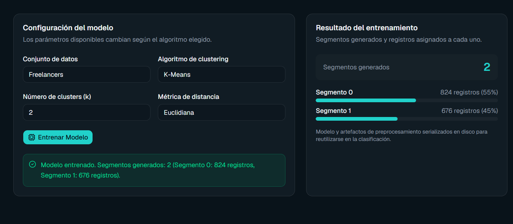

### Cluster con valor de k=2 en reseñas
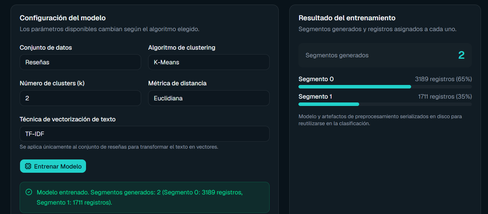

### Grafica de Freelancers con valor de k=2
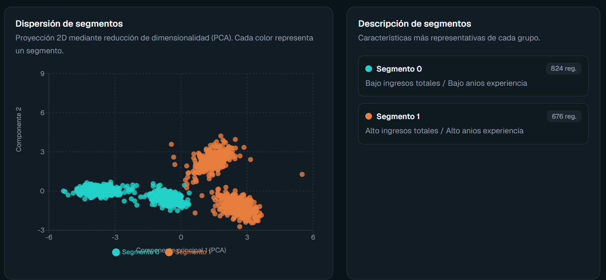

### Grafica de Reseñas con valor de k=2
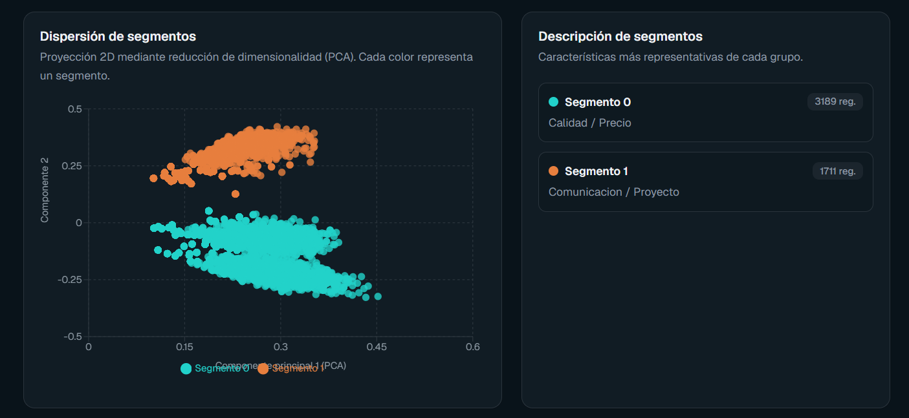

### Cluster con valor de k=3 en freelancers
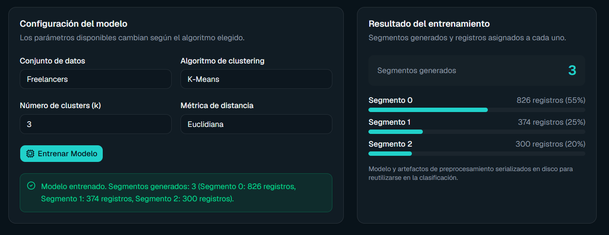

### Cluster con valor de k=3 en raseñas
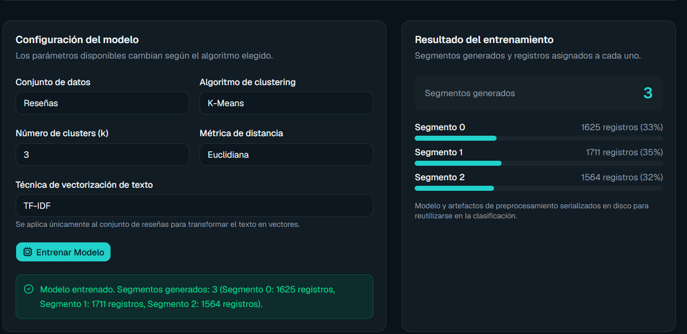

### Grafica de Freelancers con valor de k=3
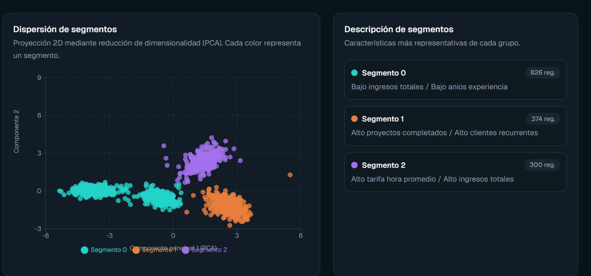

### Grafica de Reseñas con valor de k=3
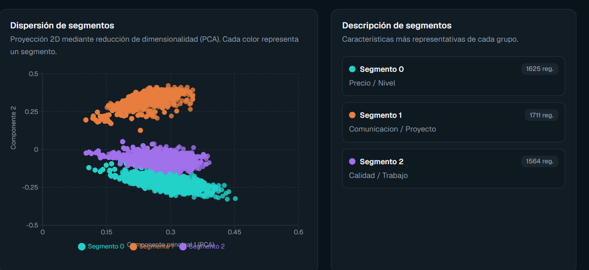

### Cluster con valor de k=4 en freelancers

### Cluster con valor de k=4 en raseñas
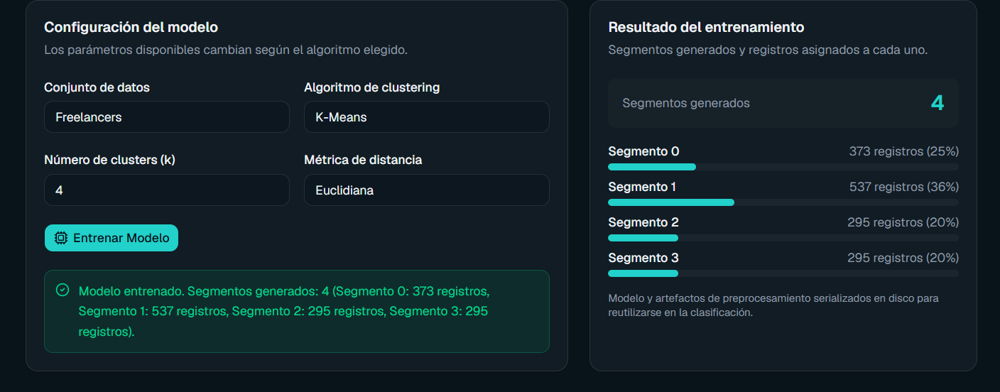

### Grafica de Freelancers con valor de k=4
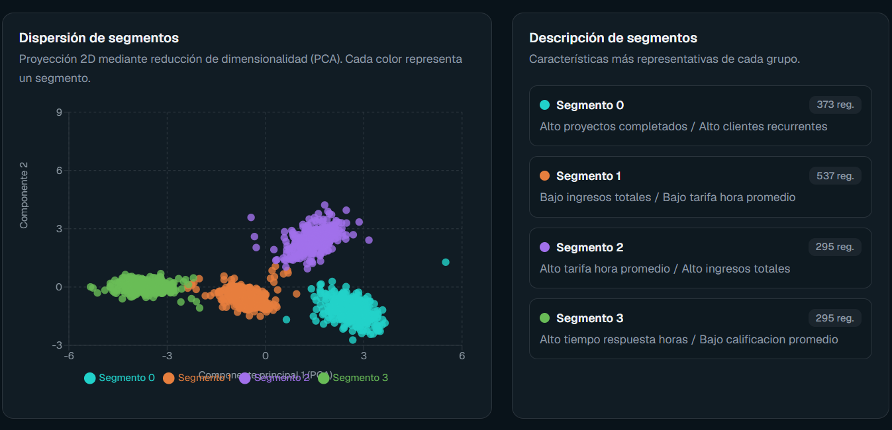

### Grafica de Reseñas con valor de k=4
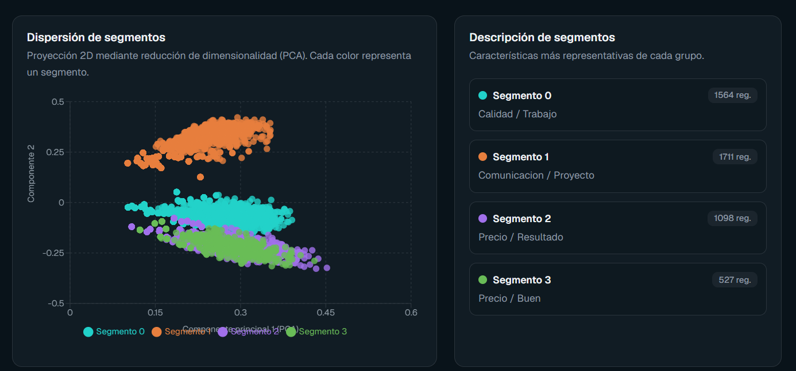

### 5.3 Impacto de métricas de validación

Las métricas de validación no se usaron únicamente como un reporte descriptivo, sino como un criterio de decisión para comparar configuraciones de `k` y, en el caso de reseñas, para verificar si el modelo elegido realmente producía segmentos útiles. En este proyecto las métricas internas cumplieron tres funciones concretas:

1. Medir la compacidad y separación de los clusters.
2. Detectar sobresegmentación, especialmente cuando aparecen clusters demasiado pequeños.
3. Evitar decisiones basadas en una sola métrica, porque cada indicador captura una propiedad distinta del agrupamiento.

#### 5.3.1 Freelancers: impacto directo de las métricas sobre la elección de `k`

En el dataset de freelancers, las métricas muestran una tendencia muy clara al aumentar `k` de 2 a 4: la silueta mejora de forma sostenida, Davies-Bouldin desciende y Calinski-Harabasz alcanza su mejor valor en `k=4`. Al pasar a `k=5`, la silueta mejora apenas, pero el agrupamiento pierde valor de negocio por la aparición de un cluster extremadamente pequeño.

| k | Silhouette | Davies-Bouldin | Calinski-Harabasz | Lectura técnica |
|---|---|---|---|---|
| 2 | 0.4035 | 1.1075 | 1078.74 | Separación aceptable, pero demasiado general; mezcla perfiles heterogéneos. |
| 3 | 0.4720 | 0.8026 | 1111.70 | Mejora clara frente a `k=2`, aunque todavía existe traslape entre segmentos. |
| 4 | 0.5187 | 0.7284 | 1594.95 | Mejor equilibrio entre cohesión, separación e interpretabilidad. |
| 5 | 0.5252 | 0.6481 | 1419.14 | Mejora marginal en silueta, pero aparece un cluster residual de solo 4 registros. |

**Análisis exhaustivo:**

| Observación | Impacto sobre la decisión |
|---|---|
| La silueta pasa el umbral de 0.5 en `k=4` | Indica que la separación es ya suficientemente buena para hablar de segmentos estables. |
| Davies-Bouldin cae al aumentar `k` | Muestra que los clusters se vuelven más compactos, pero no basta para elegir el modelo final por sí solo. |
| Calinski-Harabasz alcanza su máximo en `k=4` | Confirma que `k=4` logra la mejor relación entre separación entre grupos y dispersión interna. |
| `k=5` produce un cluster de 4 registros | Sugiere sobreajuste del agrupamiento: el modelo empieza a perseguir outliers en lugar de crear perfiles generales. |

En freelancers, por tanto, la métrica que más pesó en la decisión final fue la combinación de **silueta + Calinski-Harabasz + tamaño razonable de los clusters**. Davies-Bouldin ayudó a confirmar la tendencia, pero no fue el único criterio. La consecuencia práctica es que `k=4` se interpreta como el punto de equilibrio entre calidad geométrica y utilidad descriptiva.

#### 5.3.2 Reseñas: impacto de las métricas sobre la estructura temática

En reseñas, la lectura es distinta: las métricas son más bajas en términos absolutos porque el espacio textual comparte vocabulario común entre temas. Aun así, las métricas siguen siendo útiles para decidir cuántos grupos tienen sentido y para detectar cuándo el modelo empieza a fragmentar temas que ya eran coherentes.

| k | Silhouette (Bag of Words, `max_features=100`) | Lectura técnica |
|---|---|---|
| 2 | 0.1565 | Dos grupos todavía resultan demasiado gruesos y mezclan temas claramente distintos. |
| 3 | 0.2130 | Mejor punto de separación; aparecen tres temas interpretables y estables. |
| 4 | 0.1222 | La separación empeora; el corpus comienza a dividirse en subgrupos menos útiles. |
| 5 | 0.0653 | Sobresegmentación clara; los clusters pierden coherencia temática. |
| 6 | 0.0693 | No hay ganancia real respecto a `k=5`; persiste la fragmentación. |
| 7 | 0.0751 | La mejora es mínima y no compensa la pérdida de interpretabilidad. |
| 8 | 0.0754 | Se mantiene la debilidad de separación sin mejora operativa. |

**Lectura por métricas:**

| Métrica | Comportamiento observado | Consecuencia |
|---|---|---|
| Silhouette | Alcanza su mejor valor en `k=3` | Tres segmentos son el mejor compromiso entre separación y significado semántico. |
| Davies-Bouldin | No presenta una caída suficiente para justificar más clusters | Aumentar `k` no mejora de forma clara la relación entre cohesión y separación. |
| Calinski-Harabasz | No compensa la fragmentación adicional | El espacio textual no gana densidad interpretativa al dividirse más. |

El caso de reseñas muestra una limitación típica del clustering de texto: no siempre la mejor configuración estadística coincide con la estructura semántica más útil. En este proyecto, `k=3` es la opción que mejor traduce los temas del corpus en segmentos comprensibles, porque los nombres resultantes no son solo números: describen temas concretos como **Precio / Nivel**, **Comunicación / Proyecto** y **Calidad / Trabajo**.

#### 5.3.3 Conclusión del impacto de las métricas

| Dataset | Métrica dominante para decidir | Resultado práctico |
|---|---|---|
| Freelancers | Silhouette + Calinski-Harabasz | Se elige `k=4` porque separa bien sin crear clusters residuales. |
| Reseñas | Silhouette + interpretabilidad temática | Se elige `k=3` porque es donde el texto conserva mejor coherencia semántica. |

En síntesis, las métricas no se usaron como una cifra aislada, sino como un sistema de control cruzado. El modelo final no es el que maximiza una sola puntuación, sino el que mejor equilibra separación, estabilidad y utilidad analítica.

### 5.4 Configuración final adoptada con su justificación

La configuración final del proyecto quedó definida por el comportamiento observado en las pruebas, la coherencia con el flujo de la aplicación y la necesidad de mantener una clasificación de nuevos registros totalmente compatible con el entrenamiento.

#### 5.4.1 Configuración final por dataset

| Dataset | Preprocesamiento | Algoritmo | `k` final | Representación / reducción | Parámetros clave | Motivo principal |
|---|---|---|---|---|---|---|
| Freelancers | Limpieza, imputación, escalado estándar | K-Means | 4 | PCA a 2D para visualización | `n_init=10`, `random_state=42` | Mejor equilibrio entre calidad de métricas y perfiles interpretables. |
| Reseñas | Limpieza de texto, stopwords, vectorización | K-Means | 3 | TruncatedSVD a 2D para visualización | `TF-IDF`, `max_features=100`, `n_init=10`, `random_state=42` | Mayor coherencia temática con tres segmentos estables y descriptivos. |

#### 5.4.2 Justificación de la configuración de freelancers

La decisión final para freelancers fue `K-Means` con `k=4` sobre variables numéricas previamente estandarizadas. Esta elección se justificó por cuatro razones principales:

| Razón | Explicación |
|---|---|
| Calidad geométrica | La silueta supera 0.5 y Calinski-Harabasz alcanza su máximo en `k=4`, lo que indica buena separación real. |
| Interpretabilidad | Los cuatro segmentos se leen con claridad: bajo volumen/experiencia, alto desempeño operativo, alto valor económico y perfil de riesgo. |
| Estabilidad | No aparecen clusters residuales excesivamente pequeños, como sí ocurre al subir a `k=5`. |
| Consistencia con la vista de clasificación | K-Means permite asignar nuevos freelancers directamente al centroide más cercano con el mismo scaler. |

Además, se mantuvo `random_state=42` para reproducibilidad y `n_init=10` para reducir la sensibilidad a una única inicialización aleatoria. En visualización, se conservó PCA a 2D porque resume bien la estructura del espacio escalado sin alterar el proceso de entrenamiento.

#### 5.4.3 Justificación de la configuración de reseñas

En reseñas, la configuración final adoptada fue `K-Means` con `k=3` y vectorización `TF-IDF` con `max_features=100`. Aunque en experimentación previa Bag of Words mostró mejoras de silueta en algunos barridos, la aplicación se quedó con la configuración que mejor equilibró separación, legibilidad y estabilidad temática en la implementación final.

| Decisión | Justificación |
|---|---|
| `k=3` | Es el punto con mejor separación temática práctica: precio/nivel, comunicación/proyecto y calidad/trabajo. |
| `TF-IDF` | Da más peso a términos discriminantes y reduce la influencia de palabras frecuentes que no aportan diferenciación temática. |
| `max_features=100` | Limita el ruido dimensional y conserva vocabulario suficiente para nombrar los clusters con sentido de negocio. |
| `TruncatedSVD` | Es la reducción adecuada para matrices dispersas de texto; PCA no es la opción correcta para este espacio vectorial. |

La elección de TF-IDF también es consistente con la interfaz final del proyecto, donde el módulo de entrenamiento permite seleccionar explícitamente esa técnica. En la práctica, esta decisión favorece descripciones más ricas y estables para los segmentos, algo importante porque el objetivo del proyecto no es solo agrupar documentos, sino explicar qué representa cada grupo.

#### 5.4.4 Criterios transversales que se mantuvieron en ambos pipelines

| Criterio | Aplicación en el proyecto | Beneficio |
|---|---|---|
| Reutilización del mismo preprocesador | Se guarda junto con el modelo en `joblib` | Asegura que clasificación y entrenamiento trabajen en el mismo espacio de representación. |
| Persistencia del estado segmentado | Se almacenan los DataFrames segmentados en disco | Permite recuperar perfiles y tabla cruzada después de reinicios del servidor. |
| Interpretación automática | Cada cluster se acompaña de un nombre corto y una descripción | Facilita la lectura de negocio por encima del dato técnico. |
| Reproducibilidad | `random_state=42` y `n_init=10` | Evita resultados inestables entre ejecuciones. |

En conclusión, la configuración final no fue una elección arbitraria. Se seleccionó porque maximiza la coherencia entre las métricas, la interpretación de los segmentos y la clasificación de nuevos registros, que es el objetivo funcional más importante de TalentMosaic.

### 6.2. Evaluación e Interpretación

La evaluación del proyecto se diseñó para responder dos preguntas distintas pero complementarias: primero, qué tan buena es la separación geométrica de los clusters obtenidos; y segundo, qué significado de negocio tienen los grupos encontrados. Por eso la vista de evaluación no se limita a mostrar números, sino que combina métricas internas, lectura textual, perfilado de segmentos y una tabla cruzada que conecta ambos mundos de segmentación.

#### 6.2.1 Métricas internas de validación

El backend calcula tres métricas internas de clustering sobre la misma matriz que se utilizó para entrenar cada modelo: la matriz escalada para freelancers y la matriz vectorizada para reseñas. La implementación se apoya en `silhouette_score`, `davies_bouldin_score` y `calinski_harabasz_score`, y además reutiliza esas mismas matrices para trazar la curva del método del codo en el rango de `k = 2` a `k = 10`.

| Métrica | Qué mide | Interpretación deseada | Resultado en freelancers | Resultado en reseñas |
|---|---|---|---|---|
| Coeficiente de Silueta | Cohesión interna frente a separación respecto a otros grupos | Más cercano a 1 indica clusters compactos y bien separados | 0.52 | 0.07 |
| Índice de Davies-Bouldin | Relación entre dispersión interna y distancia entre clusters | Más cercano a 0 indica mejor separación | 0.73 | 3.82 |
| Índice de Calinski-Harabasz | Relación entre dispersión entre clusters y dentro de clusters | Más alto indica clusters más densos y separados | 1594.9 | 230.8 |

En el conjunto de freelancers, las métricas son consistentes entre sí: la silueta es superior a 0.5, Davies-Bouldin es bajo y Calinski-Harabasz es alto. En reseñas, el comportamiento es más débil, algo esperable en texto breve y temáticamente cercano, donde las palabras compartidas entre temas limitan la separación geométrica.

#### 6.2.2 Interpretación de la calidad del agrupamiento

La interpretación textual generada por el backend resume las métricas con una lectura directa del tipo: separación fuerte, moderada o débil. Esa frase no reemplaza el análisis técnico, sino que lo sintetiza para la vista de usuario.

| Dataset | Lectura técnica | Interpretación de negocio |
|---|---|---|
| Freelancers | Los segmentos están bien separados entre sí. | El modelo encontró perfiles claramente distinguibles por volumen de trabajo, ingresos, experiencia y desempeño. |
| Reseñas | Los segmentos se traslapan considerablemente; la separación es débil. | Los temas de las reseñas comparten vocabulario común y la frontera semántica entre grupos es menos nítida. |

Este resultado no implica que el modelo de reseñas sea incorrecto. En este proyecto, el objetivo no es clasificar texto con alta precisión supervisada, sino descubrir estructuras temáticas interpretables. Por eso, aun cuando la silueta sea baja, los clusters siguen siendo útiles si sus términos dominantes y sus perfiles descriptivos son coherentes.

#### 6.2.3 Descripción razonada de los segmentos encontrados

El perfilado de segmentos se construye con dos lógicas distintas según el tipo de dato. En freelancers, cada cluster se resume con promedios por variable y un nombre corto derivado de z-scores. En reseñas, el resumen se apoya en los términos con mayor peso medio y en un nombre corto formado por las palabras más representativas del cluster.

**Freelancers**

| Segmento | Registros | Descripción corta | Rasgos dominantes observados |
|---|---|---|---|
| 0 | 373 | Bajo ingresos totales / Bajo años experiencia | Perfil joven, con menor volumen histórico y menor madurez profesional. |
| 1 | 537 | Alto proyectos completados / Alto clientes recurrentes | Perfil operativo y consistente, con buena retención de clientes y alta actividad. |
| 2 | 295 | Alto tarifa hora promedio / Alto ingresos totales | Perfil de mayor valor económico, asociado a tarifas altas y mejores ingresos. |
| 3 | 295 | Alto tiempo respuesta horas / Bajo calificación promedio | Perfil más riesgoso, con tiempos de respuesta altos y desempeño percibido más débil. |

**Reseñas**

| Segmento | Registros | Descripción corta | Términos dominantes |
|---|---|---|---|
| 0 | 1625 | Precio / Nivel | vocabulario asociado al costo, nivel del servicio y percepción del valor recibido. |
| 1 | 1711 | Comunicación / Proyecto | comentarios sobre seguimiento, claridad y desarrollo del trabajo. |
| 2 | 1564 | Calidad / Trabajo | referencias a calidad, ejecución y resultado final. |

La interpretación de estos segmentos es consistente con la forma en que se construyeron los modelos. En freelancers, las variables se estandarizaron para que ninguna domine por escala; en reseñas, el vectorizador prioriza los términos más discriminantes y el clustering agrupa documentos con patrones léxicos similares. Esto explica por qué los nombres de los clusters no son arbitrarios: surgen de diferencias estadísticas reales dentro de cada grupo.

#### 6.2.4 Análisis de la tabla cruzada de segmentos

La tabla cruzada relaciona los segmentos de freelancers con los de reseñas a través de `freelancer_id`. El cálculo se hace con una intersección entre ambos datasets ya segmentados y luego se resume con una tabla de contingencia. La vista muestra, para cada segmento de freelancers, cuántas reseñas asociadas caen en cada segmento de reseñas y qué porcentaje representa cada celda dentro de su fila.

| Freelancers \ Reseñas | Seg. reseña 0 | Seg. reseña 1 | Seg. reseña 2 |
|---|---:|---:|---:|
| Seg. freelancer 0 | 594 (33.43%) | 617 (34.72%) | 566 (31.85%) |
| Seg. freelancer 1 | 404 (31.37%) | 469 (36.41%) | 415 (32.22%) |
| Seg. freelancer 2 | 381 (33.54%) | 383 (33.71%) | 372 (32.75%) |
| Seg. freelancer 3 | 130 (36.21%) | 121 (33.70%) | 108 (30.08%) |

**Lectura técnica del cruce:**

| Hallazgo | Interpretación |
|---|---|
| Distribución por fila casi uniforme | No existe una correspondencia fuerte de uno a uno entre perfiles de freelancers y temas de reseñas. |
| Diferencias porcentuales pequeñas entre columnas | Las reseñas no dependen de forma determinista del segmento del freelancer; varios perfiles reciben mezclas temáticas parecidas. |
| Concentración moderada de volúmenes en todos los cruces | La relación entre ambos modelos es más contextual que jerárquica: el mismo freelancer puede recibir reseñas de varios temas. |

Desde el punto de vista de negocio, esto es valioso porque evita sobrerreaccionar ante una correspondencia aparente. La tabla cruzada no dice que un segmento de freelancers “posea” un único tipo de reseña; más bien muestra que el desempeño del freelancer y el contenido de la reseña se relacionan, pero no de forma exclusiva.

### 7. Clasificación de Nuevos Registros

La clasificación de registros nuevos reutiliza el modelo ya entrenado y los artefactos de preprocesamiento persistidos en disco. En este proyecto no se construyó una estrategia aproximada para algoritmos sin `predict()`: se seleccionó K-Means precisamente porque sí permite asignar una observación nueva al centroide más cercano de manera nativa y reproducible.

#### 7.1.1 Estrategia de asignación utilizada

| Tipo de registro | Estrategia | ¿Es nativa del algoritmo? | Flujo real de clasificación |
|---|---|---|---|
| Freelancer | K-Means sobre variables numéricas escaladas | Sí | El nuevo registro se transforma con el mismo `StandardScaler` ajustado en entrenamiento y luego se aplica `predict()` del KMeans persistido. |
| Reseña | K-Means sobre vectores de texto | Sí | El texto nuevo se limpia, se vectoriza con el mismo vectorizador entrenado y luego se aplica `predict()` del KMeans persistido. |

Esta estrategia es válida porque K-Means define explícitamente un espacio métrico con centroides. Clasificar un nuevo registro no exige reentrenar; basta con ubicarlo en el mismo espacio de características que utilizó el modelo y medir su cercanía a los centroides aprendidos. La asignación resultante es consistente con el objetivo del algoritmo: minimizar la distancia al centroide más próximo.

#### 7.1.2 Persistencia de modelos y preprocesamiento

Para mantener coherencia entre entrenamiento y clasificación, el backend serializa el modelo y su preprocesamiento asociado en un único archivo por dataset mediante `joblib`. Así se garantiza que el registro nuevo se procese con exactamente los mismos parámetros que el conjunto de entrenamiento.

| Archivo serializado | Contenido | Uso posterior |
|---|---|---|
| `models_storage/freelancers_kmeans.pkl` | `scaler`, `modelo` y, si está disponible, `pca` | Permite escalar nuevos freelancers y recuperar la proyección 2D para visualización sin volver a ajustar el modelo. |
| `models_storage/resenas_kmeans.pkl` | `vectorizador`, `modelo` y, si está disponible, `svd` | Permite vectorizar nuevas reseñas con el mismo vocabulario y recuperar la proyección 2D sin reentrenar. |
| `models_storage/freelancers_segmentado.pkl` | DataFrame segmentado de freelancers | Se usa para recuperar el estado después de reinicios y para reconstruir descripciones de segmentos. |
| `models_storage/resenas_segmentado.pkl` | DataFrame segmentado de reseñas | Se usa para recuperar el estado después de reinicios y para reconstruir descripciones de segmentos. |

#### 7.1.3 Flujo de serialización y recuperación

| Fase | Acción realizada | Resultado |
|---|---|---|
| Entrenamiento | Se ajusta el preprocesador y el K-Means sobre el dataset limpio. | Se obtienen etiquetas, perfiles y métricas internas. |
| Serialización | Se guarda un diccionario con `joblib.dump()`. | Quedan persistidos el modelo y los transformadores necesarios para reutilizarlos. |
| Recuperación | El endpoint de clasificación carga el archivo con `joblib.load()`. | El sistema evita reentrenar y conserva la lógica exacta del entrenamiento. |
| Transformación de nuevos datos | Se aplica `transform()` con el mismo escalador/vectorizador. | El nuevo dato queda en el mismo espacio de características que los clusters originales. |
| Predicción | Se ejecuta `predict()` del K-Means persistido. | Se obtiene el segmento asignado al nuevo registro. |
| Rotulado interpretativo | Se recupera el perfil del cluster desde el estado en memoria o desde disco. | El usuario recibe no solo el número de segmento, sino también su nombre corto y una descripción de negocio. |

#### 7.1.4 Justificación técnica de la validez

| Decisión | Justificación |
|---|---|
| Reutilizar el mismo preprocesador | Evita desalineaciones entre entrenamiento y clasificación; un nuevo escalado o un vocabulario nuevo producirían espacios incompatibles. |
| No usar una heurística aproximada | K-Means sí ofrece predicción nativa, por lo que no es necesario aproximar la pertenencia del nuevo registro. |
| Guardar también el estado segmentado | Permite reconstruir descripciones, tablas y nombres de segmento aunque el servidor se reinicie. |
| Mantener PCA y SVD solo como artefactos auxiliares | Se usan para visualización y recuperación de la proyección 2D, pero no alteran la asignación del segmento. |

En síntesis, la Vista 5 no inventa una lógica nueva de clasificación: reaplica exactamente el mismo espacio de representación y el mismo modelo que se ajustaron en la Vista 2. Esa consistencia es la que hace válida la asignación de un registro nuevo dentro del flujo completo del proyecto.

