<div align="center">


## UNIVERSIDAD DE SAN CARLOS DE GUATEMALA

### FACULTAD DE INGENIERÍA

### ORGANIZACIÓN DE LENGUAJES Y COMPILADORES 2

<br><br>

# MANUAL DE USUARIO - TalentMosaic
**Catedrático:** M.Sc. Luis Fernando Espino Barrios

**Auxiliar Laboratorio:** Carlos Fernando Enrique Lopez Garcia

**Grupo:**  32

**Fecha:** Junio 2026
</div>

---

# Índice

1. [Introducción a TalentMosaic](#1-introducción-a-talentmosaic)
2. [Arquitectura y Requisitos del Sistema](#2-arquitectura-y-requisitos-del-sistema)
3. [Estructura de la Plataforma](#3-estructura-de-la-plataforma)
4. [Flujo de Trabajo Paso a Paso](#4-flujo-de-trabajo-paso-a-paso)
    - [4.1. Carga y Preprocesamiento de Datos](#41-carga-y-preprocesamiento-de-datos)
    - [4.2. Configuración y Entrenamiento del Modelo](#42-configuración-y-entrenamiento-del-modelo)
    - [4.3. Interpretación y Perfilado de Segmentos](#43-interpretación-y-perfilado-de-segmentos)
    - [4.4. Evaluación y Validación del Modelo](#44-evaluación-y-validación-del-modelo)
    - [4.5. Clasificación de Nuevo Registro](#45-clasificación-de-nuevo-registro)
    - [4.6. Exportación de Reportes](#46-exportación-de-reportes)
5. [Guía de Análisis de Resultados e Interpretación](#5-guía-de-análisis-de-resultados-e-interpretación)
6. [Solución de Problemas (Preguntas Frecuentes)](#6-solución-de-problemas-preguntas-frecuentes)

---

## 1. Introducción a TalentMosaic

Bienvenido a **TalentMosaic**, una poderosa herramienta de análisis basada en **aprendizaje no supervisado** diseñada para plataformas de trabajo independiente (freelance).

En un mercado donde miles de freelancers generan constantemente datos de desempeño y reseñas textuales, resulta extremadamente difícil identificar patrones ocultos de forma manual. **TalentMosaic** resuelve este problema mediante técnicas de *clustering* que permiten:

- **Segmentar freelancers** según su desempeño real (ingresos, tasa de finalización, experiencia, etc.).
- **Agrupar temáticamente** las reseñas de clientes para descubrir qué aspectos valoran o critican.
- **Cruzar ambos mundos** para obtener insights profundos.
- **Clasificar nuevos registros** sin necesidad de reentrenar el modelo.

Esta aplicación transforma datos complejos en conocimiento accionable, apoyando la toma de decisiones estratégicas en plataformas de freelancing.

El presente manual está orientado a **usuarios finales** (analistas de datos, gerentes de producto, administradores) y explica el uso completo de la aplicación sin requerir conocimientos previos de programación.

---

## 2. Arquitectura y Requisitos del Sistema

### Requisitos Mínimos
- **Navegador web:** Google Chrome (versión 90 o superior), Mozilla Firefox (88+) o Microsoft Edge actualizado.
- **Resolución recomendada:** 1920x1080 (Full HD) para una mejor visualización de gráficas y tablas.
- **Archivos de entrada:** Dos archivos CSV delimitados por comas (`,`):
  - `freelancers.csv`: Perfil y métricas de desempeño.
  - `reseñas_clientes.csv`: Reseñas textuales de clientes.

### Estructura Técnica y Ejecución Local
TalentMosaic cuenta con un **Backend en Python (FastAPI)** responsable de la limpieza de datos y modelado de Machine Learning, y un **Frontend moderno (Next.js/React)** para la interfaz web. Ambos servidores deben estar en ejecución simultáneamente.

**Paso 1: Ejecutar el Backend (Python/FastAPI)**
1. Abra una terminal y navegue a la carpeta `Backend` del proyecto.
2. Cree un entorno virtual y actívelo (Recomendado):
   - **Windows:** `python -m venv venv` y luego `venv\Scripts\activate`
   - **Mac/Linux:** `python3 -m venv venv` y luego `source venv/bin/activate`
3. Instale las dependencias necesarias:
   ```bash
   pip install -r requirements.txt
   ```
4. Copie la plantilla de variables de entorno:
   - **Windows:** `copy .env.example .env`
   - **Mac/Linux:** `cp .env.example .env`
5. Inicie el servidor de desarrollo:
   ```bash
   python main.py
   ```
El backend estará corriendo y escuchando peticiones en `http://localhost:8000`.

**Paso 2: Ejecutar el Frontend (Next.js)**
1. Abra una nueva terminal y navegue a la carpeta `Frontend` del proyecto.
2. Instale las dependencias usando pnpm (requiere Node.js 18+):
   ```bash
   pnpm install
   ```
3. Conecte el frontend al backend creando un archivo `.env.local` en la carpeta Frontend con la siguiente línea:
   ```env
   NEXT_PUBLIC_API_URL=http://localhost:8000
   ```
4. Inicie el servidor de desarrollo:
   ```bash
   pnpm dev
   ```
El frontend estará listo. Abra su navegador web y visite **`http://localhost:3000`** para acceder a la aplicación TalentMosaic.

---

## 3. Estructura de la Plataforma

La interfaz cuenta con un **menú lateral** que permite navegar fácilmente entre las seis vistas principales del sistema:

1. Carga y Preprocesamiento de Datos
2. Configuración y Entrenamiento del Modelo
3. Interpretación y Perfilado de Segmentos
4. Evaluación y Validación del Modelo
5. Clasificación de Nuevo Registro
6. Exportación de Reportes

<div align="center">
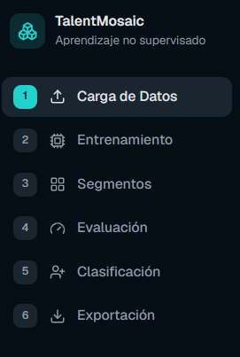
<br>
<em>Figura 1: Menú de navegación principal de la plataforma.</em>
</div>

---

## 4. Flujo de Trabajo Paso a Paso

### 4.1. Carga y Preprocesamiento de Datos

Esta vista es el punto de entrada. Permite cargar y limpiar los datos antes del análisis.

**Pasos detallados:**
1. Acceda a la sección **"Carga y Preprocesamiento"**.
2. Utilice los selectores de archivo para subir `freelancers.csv` y `reseñas_clientes.csv`.
3. Observe la **vista previa** de las primeras filas en tablas para verificar que los datos se cargaron correctamente.
4. Haga clic en **"Limpiar Datos"**.
5. El sistema detectará y corregirá problemas comunes (valores nulos, duplicados, formatos incorrectos, etc.) y mostrará un resumen de las operaciones realizadas.

**Mensajes esperados:**  
- "Datos limpiados correctamente. X registros procesados."

<div align="center">
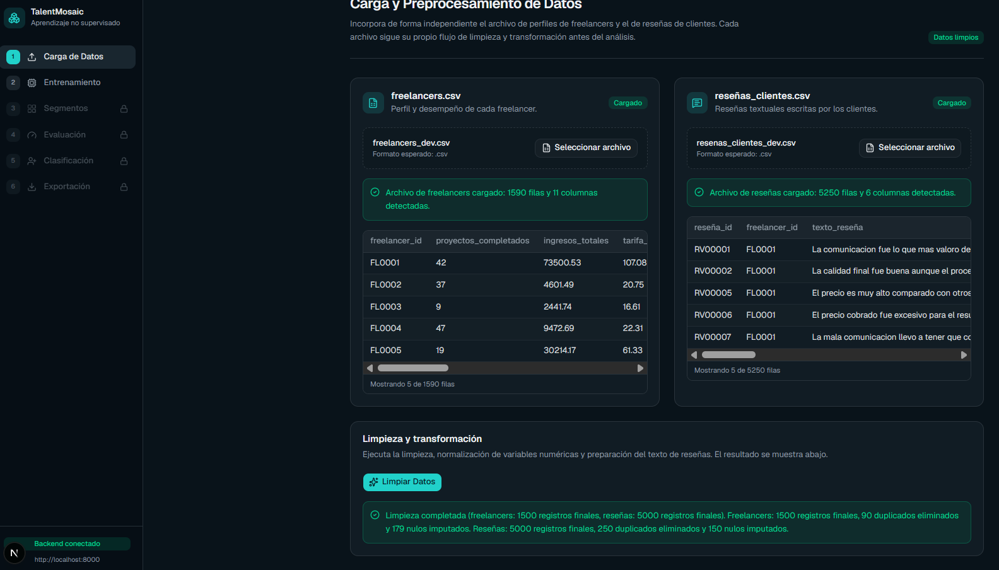
<br>
<em>Figura 2: Vista de Carga y Preprocesamiento.</em>
</div>

---

### 4.2. Configuración y Entrenamiento del Modelo

Aquí configura y entrena los modelos de clustering de forma independiente para cada conjunto de datos.

**Pasos detallados:**
1. Seleccione el conjunto de datos: **Freelancers** o **Reseñas**.
2. Elija el algoritmo:
   - **K-Means** (recomendado para principiantes): indique el número de clusters (`k`).
   - **DBSCAN**: configure `epsilon` y `min_samples`.
   - **Clustering Jerárquico Aglomerativo**.
3. Para reseñas: seleccione el método de vectorización (**TF-IDF** recomendado).
4. Ajuste los parámetros adicionales según el algoritmo.
5. Presione **"Entrenar Modelo"**.

Al finalizar, el sistema mostrará un mensaje con el número de segmentos generados y la distribución de registros.

**Nota importante:** Los modelos entrenados se guardan automáticamente para uso posterior.

<div align="center">
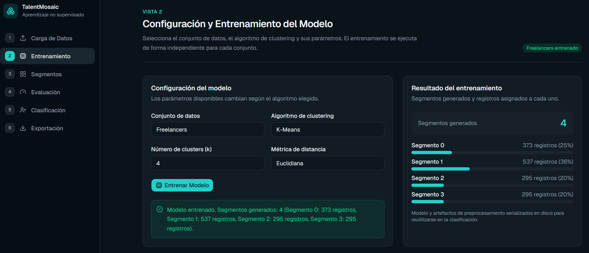
<br>
<em>Figura 3: Vista de Configuración y Entrenamiento (Freelancers).</em>
</div>
<br>
<div align="center">
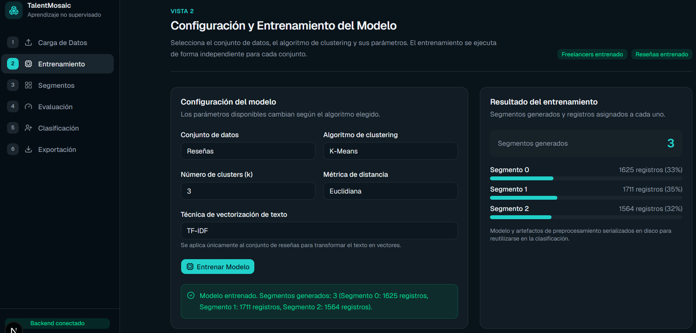
<br>
<em>Figura 4: Vista de Configuración y Entrenamiento (Reseñas).</em>
</div>

---

### 4.3. Interpretación y Perfilado de Segmentos

Esta es la vista más valiosa para la toma de decisiones.

**Elementos disponibles:**
- **Gráfica de dispersión** (con PCA para reducción de dimensionalidad).
- **Tabla resumen por segmento** (promedios, modas y conteos).
- **Descripciones textuales automáticas** de cada segmento.
- **Nube de palabras** (para reseñas) que revela los temas principales.
- **Tabla Cruzada de Segmentos**: muestra cómo se relacionan los segmentos de freelancers con los de reseñas (porcentajes y conteos). Esta tabla es clave para descubrir patrones como "qué tipo de reseñas reciben los freelancers de alto rendimiento".

**Consejo:** Lea las descripciones textuales generadas; traducen los resultados técnicos en lenguaje de negocio.

<div align="center">
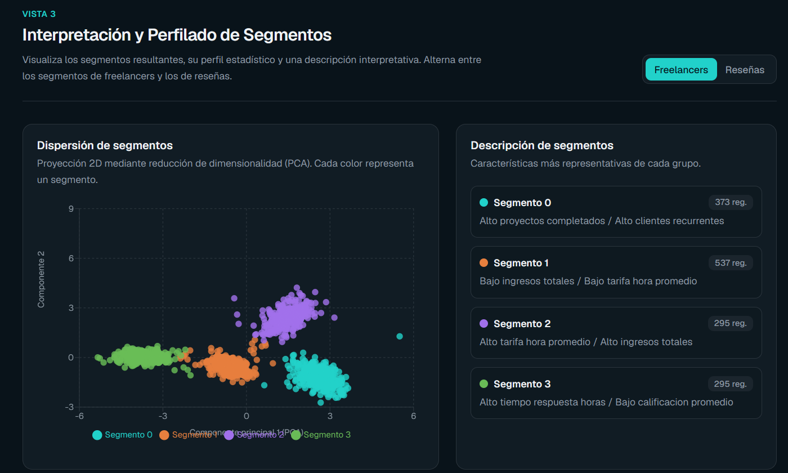
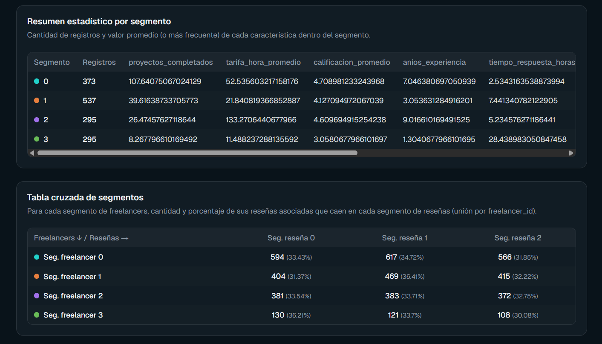
<br>
<em>Figura 5: Vista de Interpretación y Perfilado de Segmentos. (Freelancers)</em>
</div>
<br>
<div align="center">
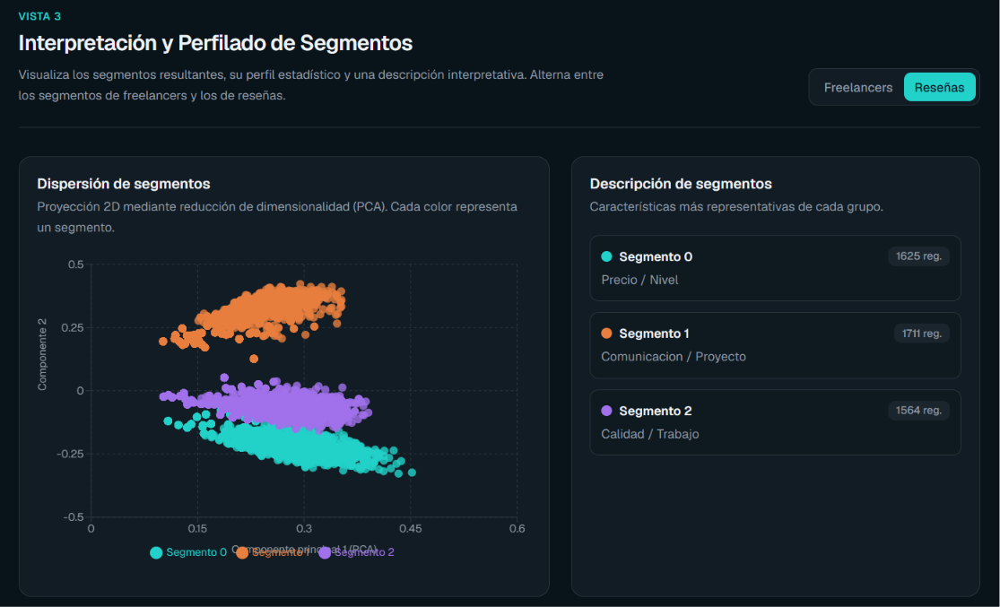
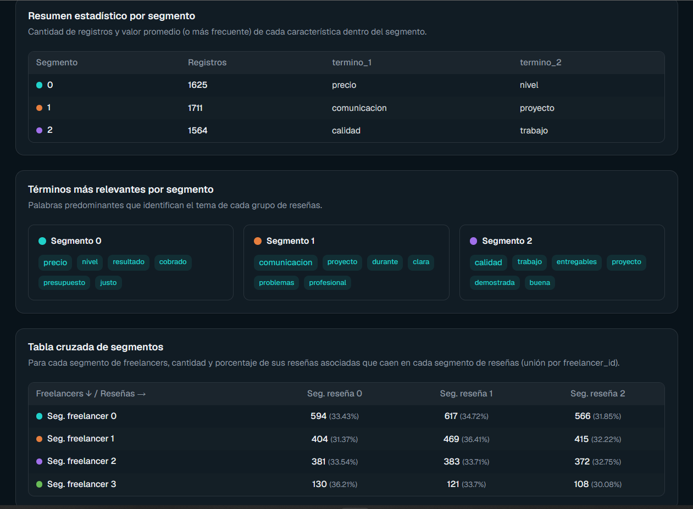
<br>
<em>Figura 6: Vista de Interpretación y Perfilado de Segmentos. (Reseñas)</em>
</div>

---

### 4.4. Evaluación y Validación del Modelo

Esta sección permite verificar la calidad de los clusters generados.

**Métricas mostradas:**
- **Coeficiente de Silueta** (ideal > 0.5).
- **Índice de Davies-Bouldin** (ideal cercano a 0).
- **Índice de Calinski-Harabasz** (mientras más alto, mejor).
- **Gráfica del método del codo** (para validar la elección de `k`).

El sistema también incluye una breve interpretación textual de estas métricas.

<div align="center">
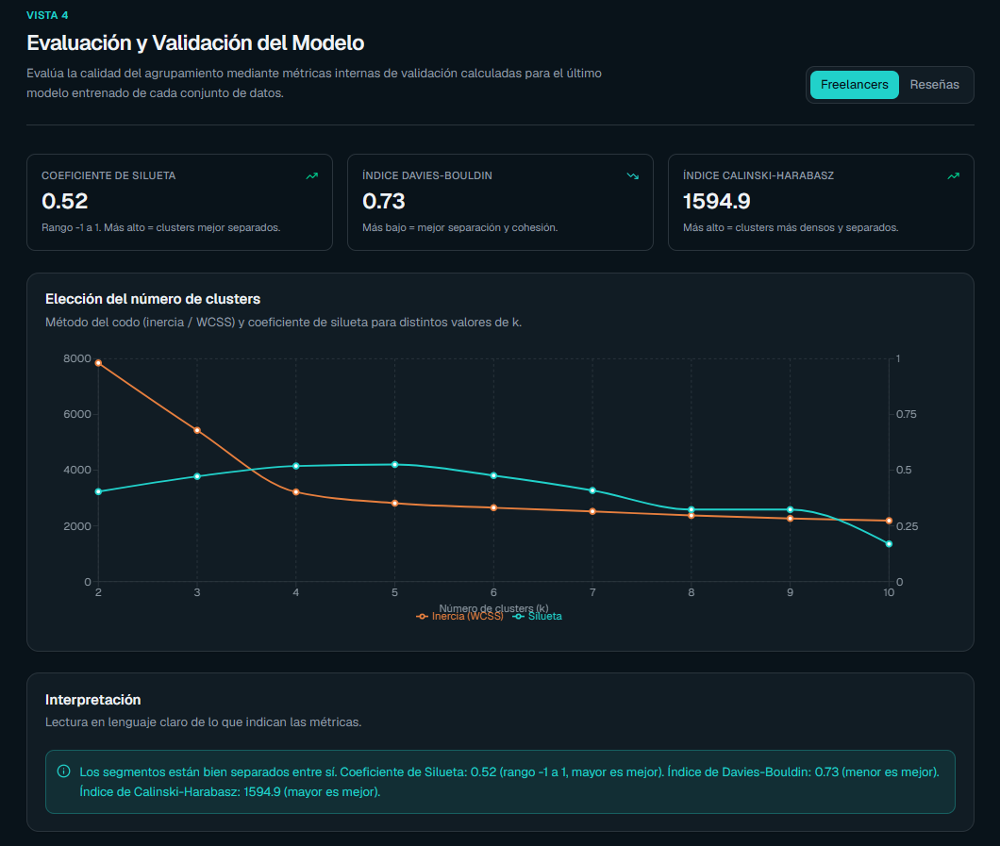
<br>
<em>Figura 7: Vista de Evaluación y Validación. (Freelancers)</em>
</div>
<br>
<div align="center">
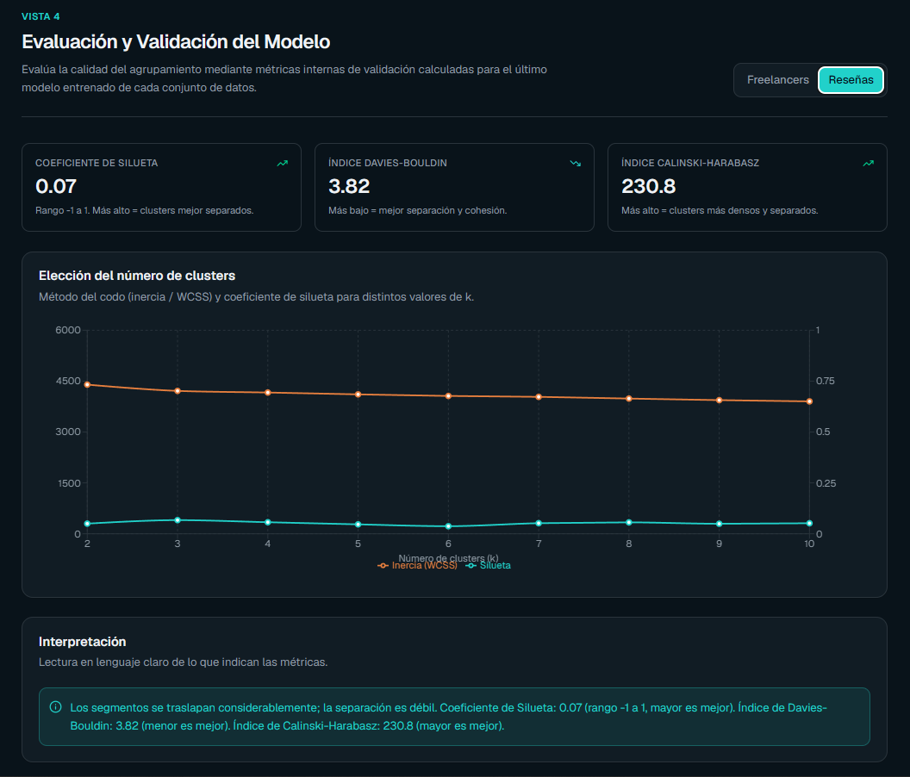
<br>
<em>Figura 8: Vista de Evaluación y Validación. (Reseñas)</em>
</div>

---

### 4.5. Clasificación de Nuevo Registro

Permite asignar un freelancer o reseña **nueva** a un segmento existente sin reentrenar.

**Pasos:**
1. Seleccione el tipo: **Freelancer** o **Reseña**.
2. Complete el formulario (para freelancers) o pegue el texto (para reseñas).
3. Haga clic en **"Asignar Segmento"**.
4. Recibirá el segmento asignado + la descripción interpretativa correspondiente.

**Ejemplo de resultado:**  
*"El freelancer fue asignado al **Segmento 2 - Freelancers de Alto Valor**. Este segmento se caracteriza por altas tarifas, excelente tasa de finalización y reseñas mayoritariamente positivas."*

<div align="center">
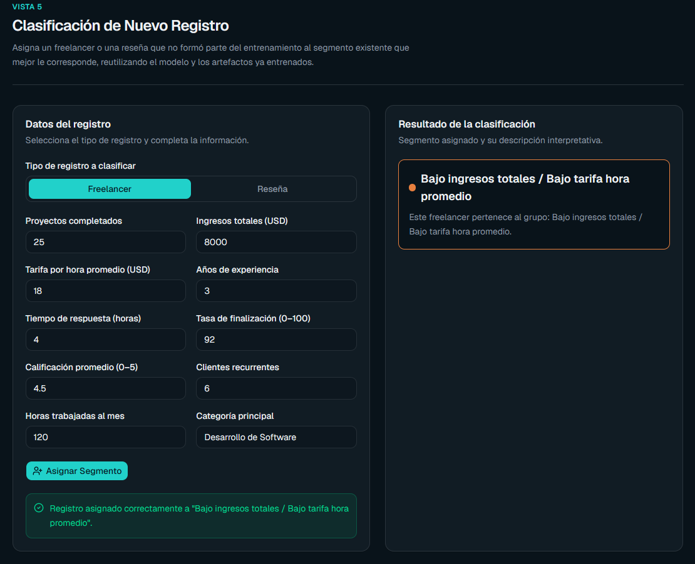
<br>
<em>Figura 9: Vista de Clasificación de Nuevo Registro. (Freelancers)</em>
</div>
<br>
<div align="center">
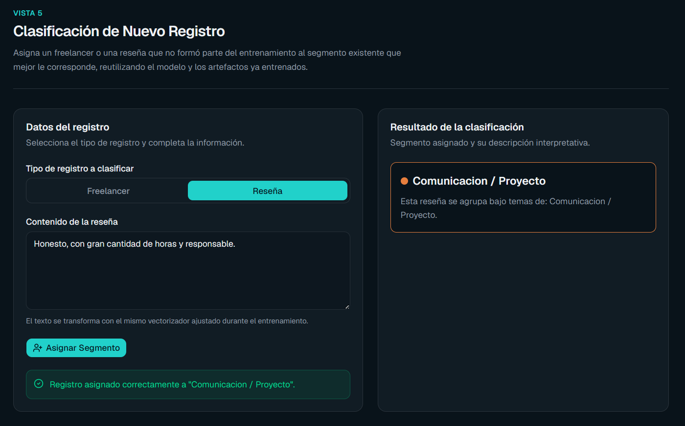
<br>
<em>Figura 10: Vista de Clasificación de Nuevo Registro. (Reseñas)</em>
</div>

---

### 4.6. Exportación de Reportes

**Elementos exportables:**
- Dataset de freelancers segmentado (CSV)
- Dataset de reseñas segmentado (CSV)
- Resumen estadístico por segmento (CSV)
- Métricas de evaluación (CSV)
- **Reporte Gráfico Ejecutivo** (PDF) que incluye gráficas, nubes de palabras y descripciones.

Seleccione los elementos deseados y presione **"Exportar Selección"**.

<div align="center">
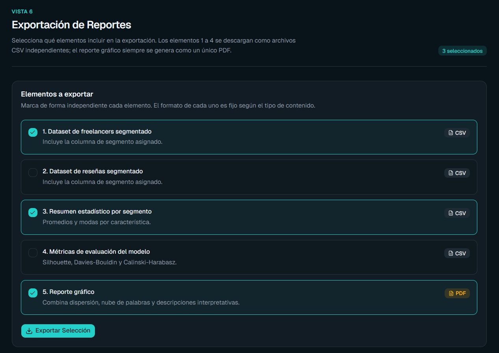
<br>
<em>Figura 11: Vista de Exportación de Reportes.</em>
</div>

---

## 5. Guía de Análisis de Resultados e Interpretación

- **Analice la Tabla Cruzada** para relacionar desempeño con percepción del cliente.
- **Identifique outliers** en las gráficas de dispersión.
- **Compare métricas** antes y después de cambiar parámetros.
- **Use las descripciones textuales** como base para informes ejecutivos.
- Si los clusters no son claros (Silueta baja), experimente con diferente `k` o algoritmo.

---

## 6. Solución de Problemas (Preguntas Frecuentes)

**1. Error: "Columnas faltantes" al cargar archivos**  
*Solución:* Verifique que los nombres de las columnas coincidan exactamente con los requeridos (incluyendo mayúsculas/minúsculas).

**2. DBSCAN asigna casi todo a "-1" (ruido)**  
*Solución:* Aumente `epsilon` o reduzca `min_samples`.

**3. La aplicación se congela durante el entrenamiento de reseñas**  
*Solución:* Espere. Si persiste, reduzca el tamaño de la muestra de reseñas.

**4. No se genera el PDF**  
*Solución:* Asegúrese de haber entrenado los modelos y visitado la vista de Interpretación.

**5. Error "Modelo no encontrado" al clasificar**  
*Solución:* Entrene nuevamente el modelo correspondiente.

**6. Resultados de clustering pobres (baja Silueta)**  
*Solución:* Pruebe normalizar mejor los datos, cambiar algoritmo o ajustar el número de clusters.

**7. Tabla cruzada vacía**  
*Solución:* Verifique que exista coincidencia entre `freelancer_id` en ambos archivos.

<br>
<div align="center">
<em>TalentMosaic - Descubriendo patrones ocultos en el ecosistema freelance mediante aprendizaje no supervisado.</em>
</div>